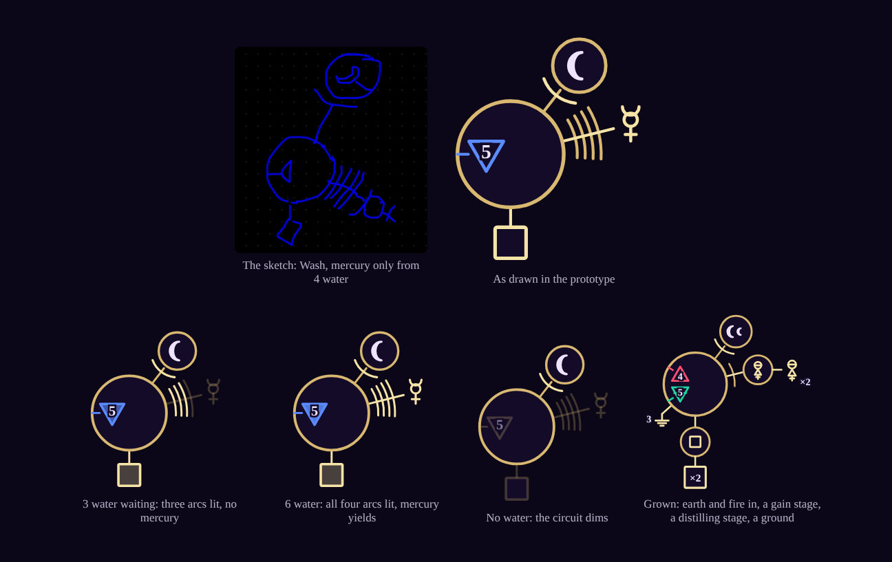

# Circuits: a new direction

Proposed, October 2026. A playable prototype is being built beside Mud to Clay. This file mirrors the "Circuits (new direction)" tab of the design doc.

Electrical schematics are a kind of runic composition. In this direction a card is a small circuit: instability flows in through its input channels, and purification flows out through its stages. Composition stays the cool factor, but it moves from play time into the run: the deck grows by adding runes to cards.

## Why

- **Turns were thinky.** A sigil composed at play time has hundreds of possible results and can't be scored in your head (see Turn complexity in DESIGN.md). A circuit card's output can: it is how much it takes in, times its gain.
- **Types stay linear.** Elements matter only on the input side, deciding which instability a card can take in. Purification is a single number, so 4 kinds of input cover the space instead of a 4×4 grid that fixed cards could never fill.
- **Transmutation becomes its own fantasy.** Turning one material into another moves from damage to crafting: processing leaves material behind, and recipes turn it into helpers, buffs and metals.

## The fight

- **The commission feeds instability into a pool,** per element, on a schedule: mud feeds mostly water and some earth.
- **Cards drain the pool** through their input channels and turn what they take into purification, plus a little material.
- **When the commission flares, whatever is above its vessel flares** and costs quintessence, less Ward. The vessel holds a few of each element safely (4 for most commissions, 3 for the boss), and what is under it stays in the pool for you to harvest. Every play is both defence (it drains the pool under the vessel) and progress (it purifies), as block and attack are in one Slay the Spire card. (At first the whole pool flared and was emptied, which wiped the stock the gates need just as a good card arrived.)
- **The commission is done when its purification requirement is met.** It asks for purification only, not for any particular element.
- **Elements work like damage types on defence.** A deck without fire channels suffers against a fire-heavy commission, so weaker any-element channels exist (half capacity, say) to make a missing element a problem rather than a hard loss.

## Cards as circuits

- **Input channel:** an element and a capacity, as in "up to 5 water".
- **Gain stage:** multiplies the card's purification.
- **Rail:** the most a card purifies in one play, 10 to start; rail runes raise it by 5. Without it, several inputs times a gain or two ran away with the fights.
- **Distilling rune:** adds a principle output to any card; the rune names the principle.
- **Later parts:** a ground or filter that soaks instability without purifying (Ward), a capacitor that stores flow for a later burst, a feedback loop (combo).
- **Beginner cards have one input and no stages:** take up to 5 water, make 5 purification, and 1 mercury once they take 4 or more.
- **Deck growth adds runes to existing cards:** another input channel, a gain stage, a principle output, a ground or a higher rail. Composition is the deckbuilding.

```
Beginner:   WATER ─┤5├──────────► purification 5, mercury 1

Grown:      WATER ─┤5├─┐
                       ├──▷ ×2──► (min(water,5) + min(air,3)) × 2
            AIR   ─┤3├─┘
```

## Time: the celestial tracker

There are no turns. Every card costs time on a dial, and the dial's phases carry the events.

- **The moon.** The dial shows the moon's eight phases, and a fight opens at the first quarter. A beginner card costs an eighth of the moon, and each phase feeds the pool. You draw at every quarter. A weak commission flares at every full and new moon; a tough one flares at every quarter and grows at the phases between. (At first a card cost a quarter of a four-phase moon; the cycle was halved to slow the feel, with play unchanged.)
- **The draw needs care.** Drawing 4 every two plays grows the hand by 2 every half moon. The prototype refills the hand to 4 at every quarter instead, so you choose your best 2 of 4 before each event. But unplayed cards wait in hand for free, an advantage other deckbuilders make you pay for. **Half-moon turns** would add the discard: at every full and new moon, discard what is left and draw 4. The prototype has them as a tuning option; with overflow flares they win about half the runs, so the attacks need some rebalancing first (see the simulation below).
- **Cards can cost different amounts of time.** A quick circuit costs a sixteenth of the moon, a heavy amplifier chain a quarter. Gain stages add time, so a bigger circuit is also a slower one. "How much can I fit before the attack?" is the core decision.
- **Waiting.** When the hand can't help, waiting advances the dial an eighth, so you can never stall. With no cards and nothing to brew, the moon moves on by itself to the next draw.
- **Slower trackers can stack on the moon.** The Western zodiac cycles fire, earth, air and water around the wheel (Aries, Taurus, Gemini, Cancer, then again from Leo), so a zodiac dial gives a fight elemental seasons; its modalities fit too, with mutable signs suited to transmutation. Planetary hours, by which alchemists timed their work, could make a metal cheaper in its planet's hour. A boss can run its own clock for its signature moves.

## Materials and recipes

- **Cards yield Paracelsus's three principles** from their outputs: salt, sulfur and mercury. Which principle a card yields is its own design, not its element's (Wash happens to yield mercury), and distilling runes add principle outputs to any card. A principle output needs its stage to collect 4 or more.
- **Recipes are earned.** In a fight, crafting costs time on the dial: tinctures and elixirs for one-off effects (like Slay the Spire's potions), and the homunculus of Paracelsian lore, a helper that processes a little instability at every phase by itself.
- **After a fight, metals are currency.** The sulfur–mercury theory of the Jabirian writings makes every metal sulfur and mercury in some proportion and purity, with gold the perfect balance of pure principles. Crude principles make lead; pure ones are needed for gold. That gives purity its late payoff: rewarding early, required later.
- **Metals keep their planets:** the Sun gold, the Moon silver, Mars iron, Venus copper, Jupiter tin, Saturn lead, Mercury quicksilver.
- **Two outputs make two archetypes:** a fast deck heavy on gain stages that purifies, and a greedy deck heavy on principle outputs that farms principles for helpers and gold. It is the money-against-score tension of Balatro.

## The six archetypes, again

| Archetype | As circuits |
| --- | --- |
| Consistent ward | Grounds and filters that soak instability |
| Combo | Feedback loops |
| One great rune | One card with a long amplifier chain |
| Purity maxing | Pure principles for noble metals |
| Element mastery | Many input channels for one element |
| Deck thinning | Fewer, bigger circuits |

## What carries over

Elements, purity grades, rune bodies and rarities, motes as card parts, the archetypes, the sigil art and the sound carry over. The amalgam and its target bands, the runepath equation and composing at play time are left behind.

## Runic schema, version 1

A card is drawn as an alchemical circuit, from the designer's sketch of Wash. Reading the drawing explains the card; words are only in a popup.

- **Stages are circles.** Sigils inside a stage are its inputs, each with a lead to the rim. Sigils outside are its outputs, and lines to other stages are links.
- **Arcs are requirements.** One arc where a link meets the stage before means that stage must run; the link ends at the arc. N arcs on an output mean the stage must collect at least N for that output to fire.
- **Shapes name mechanics.** A crescent is time: an eighth of the moon each, a small one for a sixteenth. A triangle is an element, drawn as the alchemical element triangles: fire and air point up, water and earth down, air and earth are barred, and the hexagram of all four takes any. A square is purification, and a square drawn around it (circumscribed) multiplies it once more; a circle there would wrongly mean another stage. The principles keep their alchemical signs; a shield is Ward; a ground drains instability away. Later sigils will stand for quintessence, cards in hand and so on.
- **A card** is a small time stage (its crescents, with leads to the top) linked by one arc to a collecting stage holding its element triangles in a column, each with a level lead to the rim and the most it takes. The collector outputs its square below and its side outputs to the right, principles or shields, each on its own line behind its own arcs. Grounds hang down to the left.
- **The drawing shows the live state.** Triangles fill with what they would take from the pool now, arcs light one by one as the take grows, outputs that would fire glow, and a card with nothing to take dims.



Wash, as sketched: a moon is its input and its circle must run before the collecting stage can; that stage takes up to 5 water and purifies 1 for each, and only from 4 water or more does it also yield mercury.

## To do

- **Extend the runic schema** to sigils for quintessence, cards in hand, Ward and other resources, as stronger cards need them.
- **Half-moon turns.** Discard and draw 4 at every full and new moon, so holding cards costs something; rebalance the attack cycles for it.
- **Make decisions meaningful.** The play loop works but offers few real choices; thresholds like Wash's (wait for the pool to fill, or wash now?) are one lever.
- **Tune the numbers:** feed rates, purification requirements, card capacities, the draw rule.
- **Decide crafting:** which recipes are in-fight, what each costs in time and material, how recipes are earned.
- **The pool after a flare.** The prototype flares only what is over the vessel; the menu keeps the old rule (flare and empty the pool) and a harsher one (flare the whole pool and keep it) to compare, though only overflow is tuned.
- **Try the zodiac and planetary trackers** once the moon works.

## Prototype

A separate page beside Mud to Clay (`circuits.html`), on one screen: the moon dial with the pool in its middle, materials and recipes always in view, the hand of circuit cards drawn with the runic schema, and a note that always explains whatever is picked, in its own slot under the dial (beside the game on wide screens). Only the menu and the reading guide open over the game. It plays a run of four commissions with single-number purification, overflow flares, rails, the three principles, three recipes (a tincture for Ward, a spirit to draw 2, the homunculus), metal smelted after each fight, and runes added to cards between fights; the shop explains each rune in words and shows the card before and after.

- **Commissions,** each fed at every phase; what is over the vessel flares. Mud: 4 water and 2 earth, vessel 4, flares at every full and new moon, needs 30. The peat bog: 3 water, 3 earth and 1 fire, vessel 4, flares at every full and new moon, needs 45. The Fumarole: 3 air, 3 fire and 1 water, vessel 4, flares at every full and new moon, needs 40; it is there so a deck built only for water and earth suffers. The Mire: 4 water, 3 earth and 1 fire, vessel 3, grows by an earth at every crescent and gibbous moon, flares at every quarter, needs 50. The run starts with 60 quintessence.
- **The opening deck** is ten one-input circuits. The metal creators, four Wash (5 water, mercury), three Calcine (5 earth, salt), a Fan (5 air, mercury) and a Kindle (5 fire, sulfur), yield their principle once they take 4 or more. The Sieve (3 of any element) raises Ward, 1 for each it takes. Every card purifies at most its rail in one play, 10 to start. A card holds at most 3 inputs, 2 gains, 3 side outputs, 2 grounds and 2 rail runes (a rail of 20); distilling runes (salt, sulfur or mercury) go on any card.
- **Recipes.** Tincture of salt: 2 salt, a sixteenth of the moon, Ward 6. Spirit of mercury: 3 mercury, a sixteenth, draw 2. Homunculus: 3 mercury, 2 salt and 1 sulfur, an eighth, then it drains 2 of the most plentiful instability and purifies 2 at every phase.
- **Metal.** Silver from 2 mercury and a salt (worth 3), lead from any two principles (worth 1). The first rune between fights is free; more cost 3 metal.

### Simulated strategies

`scripts/circuits-sim.ts` plays the run three ways (500 runs each, refilling to 4 at every quarter, 60 quintessence, overflow flares, rails):

- **Greedy** plays, brews or waits for whatever looks best right now: purification, quintessence kept, the pool it would face, helpers, Ward, cards in hand. It ignores the gates. Between fights it takes gains first, then rails for cards that outgrow theirs, then inputs for the elements the coming commissions feed most.
- **Random** makes any legal move, and puts random runes on random cards.
- **Delay** keeps the fights before the boss going to gather principles, as long as doing so doesn't lose: a move is allowed only if playing greedy after it would still finish the fight with a chosen reserve of quintessence. It takes the move that gathers most, else the one that purifies least, and plays greedy when nothing is allowed. The engine is deterministic, so this look-ahead is exact.

| Strategy | Runs won | Paid in Mud | Metal | Paid in Peat | Metal | Paid in Fumarole | Metal | Into the Mire |
| --- | --- | --- | --- | --- | --- | --- | --- | --- |
| Random | 0% | 19.3 | 2.9 | 27.6 | 2.5 | 29.3 | 0.0 | 4 (1% get there) |
| Greedy | 77% | 0.2 | 4.1 | 1.5 | 4.2 | 27.7 | 1.8 | 31 |
| Delay, keep 1 | 0% | 49.2 | 5.5 | 7.5 | 6.9 | 10.7 | 0.2 | 2 (7% get there) |
| Delay, keep 35 | 31% | 22.7 | 5.5 | 1.9 | 5.7 | 23.7 | 1.8 | 14 |
| Delay, keep 45 | 65% | 6.2 | 5.5 | 6.7 | 6.7 | 23.1 | 2.0 | 25 |
| Delay, keep 55 | 81% | 2.2 | 4.9 | 2.3 | 5.9 | 24.5 | 2.0 | 31 |
| Delay in Mud only, keep 55 | 79% | 2.2 | 4.9 | 1.5 | 4.2 | 25.5 | 1.9 | 31 |

The flare rules side by side, with the commissions above (greedy; fully blocked flares and metal per commission, Mud to the Mire):

| Flares | Rails | Greedy | Delay, keep 50 | Flares fully blocked | Metal | Biggest play |
| --- | --- | --- | --- | --- | --- | --- |
| Whole pool, emptied | off | 5% | 10% | 17%, 1%, 1%, 2% | 3.0, 3.1, 0.5, 0.4 | 4.9, 7.9, 9.2, 13.5 |
| Whole pool, kept | off | 2% | 2% | 0%, 0%, 0%, 1% | 2.4, 3.8, 0.3, 0.3 | 5.0, 8.6, 9.1, 12.2 |
| Over the vessel | off | 89% | 85% | 93%, 74%, 23%, 25% | 4.1, 4.2, 2.0, 3.6 | 5.0, 9.4, 10.6, 18.1 |
| Over the vessel | on | 77% | 72% | 93%, 76%, 22%, 22% | 4.1, 4.2, 1.8, 3.4 | 5.0, 8.2, 7.8, 10.8 |

- **The stock stays.** Under overflow flares a flare trims each element back to the vessel, so the pool keeps enough for a gate: greedy leaves Mud with 4.1 metal (0.7 when flares emptied the pool) without trying.
- **Full blocks are possible where they should be.** Mud's flares are fully blocked 93% of the time, the peat bog's 76%; the Fumarole and the Mire, which feed faster than an opening deck drains, about 22%. Under the old rule it was 26% in Mud and 3% in the hard fights.
- **Rails tame the runaway card.** The biggest single play in the Mire drops from 18 to 11; greedy wins 77% instead of 89%.
- **Patience is worth less now, and sacrifice still nothing.** The pool no longer empties, so even greedy hits the gates; keeping 55 wins 81%, and spending below 45 loses runs fast.
- **Building for air and fire matters less than before.** Rune picks for only water and earth inputs (`--picks wet`) win 70% instead of 77% (delay 75% instead of 81%).
- **Half-moon turns become playable.** Discarding and drawing 4 at every full and new moon (`--draw cycle`) wins 53% for greedy, against 7% under the old flare rule.
- **The draw rule** still matters most: drawing 4 at every quarter without a cap wins every run (greedy); drawing 2 wins 11%.
