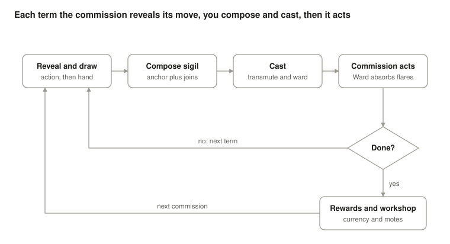
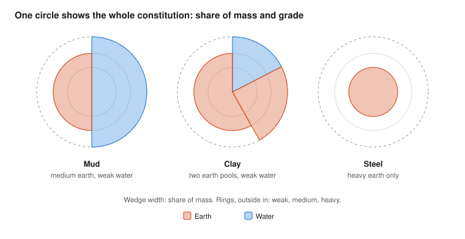
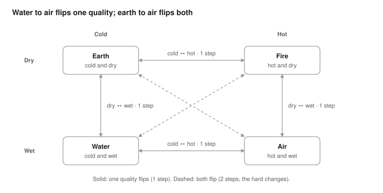
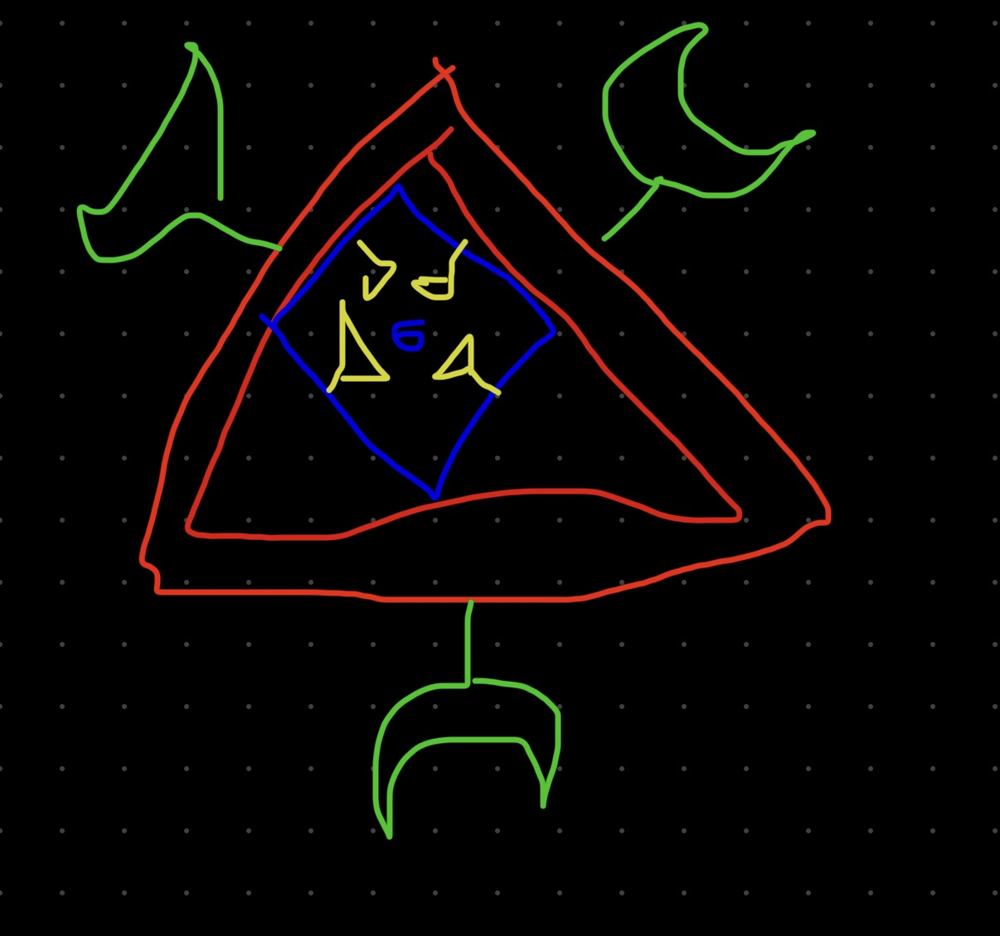

# Circumgician Deckbuilder — Design Doc

Last updated Oct 11, 2026. Started Oct 7, 2026.

## Overview

A roguelike deckbuilder in the spirit of Balatro: each term you compose sigils from the runes in your hand until it is spent, and each encounter is an alchemical transmutation. Every term makes the work more unstable, and the run ends when you can no longer pay quintessence to hold it together.

**Design pillars**

- **Every hand is a composition.** Players build a structure by circumscribing, inscribing, side-linking and entwining, rather than matching a set.
- **Runes are what they hold.** A rune's body sets its power, links and bowls; the motes in its bowls give it an element and abilities. Upgrading a rune means changing what it holds.
- **Upgrades compound.** Motes and new runes stack across a run toward big, readable payoffs.
- **Hit the target, and make plenty.** Each commission asks for a specific constitution, so overshooting is a risk, but more product earns more. This is the main departure from Balatro.
- **Alchemy you can reason about.** Elemental changes follow one consistent logic, so players can predict which changes are cheap.
- **Symmetry is stability.** A sigil's shape decides how well it holds the work together, and each class relates to that differently.
- **Familiarity pays.** Each source material attacks in a consistent, learnable way; targets supply the variety.

## Glossary

| Term | Meaning |
| --- | --- |
| Rune | A card in the deck: a body holding motes in its bowls. |
| Body | A rune's shape: circle, crescent or triangle. It sets power, links and bowls. |
| Bowl | A slot on a body that holds one mote. |
| Mote | What gives a rune its nature. Gems set the element; ability motes add links, multiply Reach or add Ward. Earned motes fill or replace bowls to upgrade a rune for the rest of the run. |
| Power | A rune's strength, set by its body. Each join turns it into Force, Reach or Ward. |
| Links | How many runes a rune holds when it anchors a sigil. |
| Sigil | One cast: an anchor plus joined runes, up to the anchor's links. A term can hold several. |
| Anchor | The rune a sigil is built from; its element is the source of the change. |
| Join | How a rune attaches to the anchor: circumscribe, side link, entwine or inscribe. Each does something different. |
| Table | The diagram that collects every sigil cast in a commission, around the amalgam. For show only. |
| Class | A deck family defined by symmetry: Regular, Isosceles or Scalene. Parked while bodies and motes settle. |
| Elemental | One of the four classical elements: Earth, Water, Air, Fire. |
| Amalgam | The substance being worked, shown as one circle. Its constitution is the share and grade of each elemental. |
| Pool | One elemental at one purity within the amalgam, such as 3 kg of impure earth. An elemental can hold several pools. |
| Weight | How much of a pool the amalgam holds, in kg. |
| Purity | How pure a pool is: impure, medium, pure, or perfect for bosses. Purer pools resist change more and act less in combat; anything transmuted comes out impure. |
| Yield | Kg produced per kg changed, set by the from→to pair. |
| Change-inertia | Umbrella for how hard a change is (grade) and how much results (yield). |
| Purifying | A runepath step that inscribes the element the path is at: purity one grade up, at one more step of resistance. Its opposite, adulterating, circumscribes it: one grade down. |
| Commission | One encounter: a source material (the opponent) to transmute into a target material (the puzzle). Balatro's blind. |
| Action pool | A source's weighted set of moves; one is rolled and revealed each term. |
| Flare | A burst of instability from the commission. Ward absorbs part; the rest costs quintessence. |
| Ward | A sigil's defensive output, from entwines and guard motes. Ward from every sigil in a term adds up. |
| Quintessence | The run's life, spent only to stabilize. The run ends when it runs out. |
| Byproduct | A split lump tethered to the main amalgam; it vanishes when the main amalgam is done. |
| Required lump | A split lump that must reach a stable state before the commission can finish. |
| Stable state | Any named substance, such as clay or dross. A lump that reaches one is settled. |
| Term | One cycle: the commission reveals its action, the player casts as many sigils as the hand allows, then ends the term and the commission acts. |
| Currency (name open) | What the workshop takes; earned from commissions in proportion to product made. |
| Reach, Force, Vector, Ward | A sigil's four outputs: kg it can affect, inertia it can overcome, the from→to change, and defence. |
| Catalyst (proposed) | A passive run modifier in a limited slot, like Balatro's jokers or another roguelike's relics. It changes every cast without being used up. |

## Core loop

A run is a chain of commissions. Each commission repeats terms until it is done. Within a term the player casts as many sigils as the hand allows, and the commission acts only when the term ends.

1. Each element in the commission may act, the less pure the likelier; every move is revealed.
2. Draw up to hand size (prototype: 6 runes).
3. Compose a sigil: an anchor plus joined runes, up to the anchor's links. Or spend a discard to redraw.
4. Read the preview: the sigil's Reach, Force, Vector and Ward against the selected pool, and what ending the term after it would cost.
5. Cast. The sigil resolves at once: the amalgam changes, mote and catalyst effects trigger, its Ward adds to the term's, and it stays on the table. If the amalgam now meets the target, the commission is done.
6. Compose and cast again while runes remain, or end the term.
7. End the term. The commission acts: the term's Ward absorbs part of any flare and the rest is paid in quintessence; disruptions hit the table. Unplayed runes stay in hand; played runes go to the discard pile. If the commission's own move leaves the amalgam in range, the commission is done once the term is paid.

A commission is done when the main amalgam meets the target and every required lump is stable. Rewards scale with the product made, so overkill pays and a poor commission still makes progress. Between commissions the player attaches motes, takes new runes and spends currency at the workshop.



Running out of quintessence ends the run.

## Runes: bodies and motes

A rune is a body holding motes. The body sets power, links and bowls; the motes in its bowls give the rune its element and abilities, so upgrading a rune means changing what it holds. Values are the prototype's starting points, all editable in its sandbox.

| Body | Power | Links | Bowls | Sides |
| --- | --- | --- | --- | --- |
| Circle | 5 | 1 | 1 | 1 |
| Crescent | 5 | 1 | 2 | 2 |
| Triangle | 5 | 1 | 3 | 3 |

| Mote | Effect | Adds or multiplies |
| --- | --- | --- |
| Basic sapphire | Water | Sets the element |
| Basic emerald | Earth | Sets the element |
| Basic topaz | Air | Sets the element |
| Basic ruby | Fire | Sets the element |
| Link mote | +1 link | Adds |
| Reach mote | The sigil's reach up ×1.5 | Multiplies |
| Guard mote | +4 Ward | Adds |
| Boost mote | +0.1 to its rune's multiplier in the equation | Adds |

**A mote defines its own effect:** what it changes, and whether it adds or multiplies. Both kinds will exist for the same stat, such as a reach mote that adds beside one that multiplies. The prototype keeps reach motes multiplicative.

**Standard starting deck: 14 runes.** It should handle an easy commission with some difficulty.

- **4 circles,** one of each element: a one-link anchor can only seal, so circles serve as cheap rings and seals.
- **8 crescents,** two of each element, each with a link mote: the workhorses, since a two-link anchor can both seal and aim.
- **2 triangles** with a link, a reach and a guard mote, and no element. Anchored, they make a pure defence sigil; joined, they bring Reach ×1.5 and +4 Ward.

**Links count only on the anchor.** A circle anchor makes a two-rune sigil; a crescent or triangle anchor makes three. The prototype first treated links as connections, so a 2-link rune anywhere carried the sigil one step deeper. Every crescent and triangle became a free extender, and a simulated player built five- and six-rune sigils that finished mud in one term.

A rune's element is its first gem; a rune without a gem has no element. Mote abilities apply wherever the rune sits in a sigil.

## Sigil composition

Leaning: each play is a floating sigil, an anchor plus joined runes up to the anchor's links, and each join turns the joined rune's power into something different.

| Join | Effect (prototyped) | Feel |
| --- | --- | --- |
| Circumscribe | Power as Force; the outermost circumscribed rune's element is the target | Multiplicative, like Balatro's mult |
| Side link | Power × 0.2 kg of Reach | Additive, like Balatro's chips |
| Entwine | Power as Ward | Defence |
| Inscribe | Power as Force; purifies if it matches the anchor's element, otherwise halves Reach for fine control | Precision |

The anchor adds its power as Force and power × 0.2 kg of Reach. Kilos converted = Reach × Force ÷ the Force the change needs, so Force past the requirement multiplies Reach. The original formula capped Force at the requirement; under the cap, the standard deck won only half its commissions against mud in simulation.

**Few, large sigils.** A term lasts until the hand is spent or the player ends it. Reach and Force multiply, so runes are worth more in one sigil than spread across several. The same six power-5 runes, a Water anchor working impure water into earth:

| Six runes cast as | Water moved |
| --- | --- |
| Three 2-rune sigils | 6 kg |
| Two 3-rune sigils | 8 kg |
| One 5-rune sigil, one rune left over | 9 kg |
| One 6-rune sigil | 12 kg |

Links therefore compound, and the expected play is one or two high-link sigils a term. A rune left out, or a stray warding sigil made from leftovers, is fine; nothing needs to use up every rune. Traces still suit small sigils, since one basic sigil already moves about 1 kg of a 2 kg trace.

**Rules**

- The anchor's element is the source of the change; the player selects which pool, and which lump, it works on.
- Inscribing a rune of the anchor's own element purifies the selected pool one grade.
- Chained circumscribes route around the elemental square: an Earth anchor circumscribed by Water, then Air, takes two easy steps instead of one hard jump. That needs an anchor with two links.
- Runes with no element add their power without changing the route.

**Example plays**

| Sigil | Result |
| --- | --- |
| Circle anchor + circumscribe | The basic transmute |
| Crescent anchor + circumscribe + entwine | Progress with some Ward |
| Crescent anchor + circumscribe + side link | More kilos, no Ward |
| Triangle anchor + two entwines | All-out defence: Ward 14, no change |
| Anchor + inscribe of its own element | Purify |

**Stabilizing patterns.** Entwines and guard motes give Ward directly.

## The table

Sigils don't vanish after a term. Each one takes effect, then joins the table around the amalgam, and the table is for show only.

- **Balance was dropped.** Runes on the table were tallied Earth against Air and Water against Fire, and imbalance added strain each term. Its only decision was whether to play a useless rune for its balance; the point is to play every rune, so balance, strain and the slump that targeted it are gone.
- **Seeing the runes on the table is fun,** so the table stays as the commission's growing diagram.
- **Each level ends with its star.** The end card draws a star with one point for every sigil cast, holding that sigil, and between the points the amalgam's composition after it: earth innermost, then water, air and fire, paler where less pure. The level reads clockwise from twelve o'clock, the start just right of the top and the finish just left of it; dotted rings mark the earth band and ticks mark where terms ended.


## Classes

**Parked.** The prototype uses bodies (circle, crescent, triangle) in place of polygons, so how symmetry classes map onto bodies and motes is open. The proposal below predates bodies.

Three classes give distinct play paths, defined by the symmetry of their polygons. Symmetry is stability, so each class has a different relationship to instability.

| Class | Shapes | Identity (proposed) | Join aptitude and stability (proposed) |
| --- | --- | --- | --- |
| Regular | Regular polygons; many axes of symmetry | Steady: wards cheaply but progresses slowly | Entwines well; symmetric placements come easily |
| Isosceles | One axis of symmetry | Directed: precise routes and fine yields, the Vector class | Side-links well; stabilizes by pairing mirrored shapes base to base |
| Scalene | No axis of symmetry | Volatile: hits hardest; some elements grow stronger as instability rises | Circumscribes well; rarely wards, so it pushes progress and pays quintessence |

Runes from other classes are sometimes offered, and taking them isn't always good. The cost comes from existing rules rather than a penalty: a scalene rune breaks a regular sigil's symmetry, while a regular rune gives a scalene deck a stable anchor. Off-class runes also dilute the draws a class depends on, such as isosceles pairs.

## Deck progression

Runes improve by changing what their bowls hold; the deck grows by earning new runes and, proposed, shrinks by dissolving them.

- **Motes.** Earned motes go into empty bowls or replace what a bowl holds, for the rest of the run. Gems change the element; ability motes add links, multiply Reach or add Ward; later motes can add triggers such as "retrigger when inscribed". Bowls are scarce, so placement is a decision.
- **Bodies (proposed).** A body upgrade could add a bowl or power, so a circle grows into something that holds more.
- **New runes.** Earned from commission rewards or bought in the workshop, in rarity tiers. Runes from other classes appear only sometimes.
- **Currency.** The workshop takes an ordinary currency (name open), earned from commissions in proportion to product made. Quintessence is never spent here.
- **Dissolving (proposed).** Retire a rune and recover its motes. Thinning lets players focus a deck, and recovering motes makes it feel like a gain.
- **Formulae (proposed).** Consumables that level up a join type, like Balatro's planet cards.
- **Catalysts (proposed).** The game's jokers and relics: passive modifiers in limited slots. A catalyst speeds a reaction without being used up, as these change every cast and stay. Examples: vitriol adds 2 power to runepaths that end in fire; sal ammoniac counts tangents twice in reach down; the alkahest, a rare one, skips the first flip of every runepath. Alchemical vessels, such as the athanor and alembic, could name the slots that hold them.

## Archetypes

Six archetypes, each built on a resource of its own, so a mote, rune or catalyst can feed one or pay it off. Plain stat motes (link, reach, guard, boost) stay as commons, the glue every deck uses. An archetype's identity comes from uncommon enablers, rare payoffs and the catalysts that reward it. Names are working names.

| Archetype | Its resource | Enablers | Payoffs | Tested by |
| --- | --- | --- | --- | --- |
| Consistent ward | Ward that doesn't depend on the draw | Glaze, crucible, lute | Press | One huge flare; flares that pierce Ward |
| Combo | Casts in a term | Cohobation, distillation | Pelican; loops that never end | Commissions that flare for every cast past a count |
| One great rune | One rune's growth | Multiplication, lodestone | The rune finishes alone; projection keeps it growing across the run | Moves that drain the strongest rune, binds |
| Purity maxing | Purity grade | Rectification, digestion | Exaltation, aqua vitae, purity targets | Purity-gated enemies (see Purity as a goal) |
| Element mastery | One or two elements | Resonance, mercurial | Magnesia, attunement | Targets in other elements, tight trace bands |
| Deck thinning | Deck size | Calcination, dissolving in the workshop | Salt of the caput mortuum, reshuffle triggers | Commissions that seed slag, like the Mire |

**Consistent ward.** Today Ward is spiky: it needs entwines or guard runes in hand, and they compete with progress. This archetype's Ward rides on sigils the player casts anyway, or arrives without casting.

- **Glaze:** its sigil gains 2 Ward for every rune in it, so a big progress sigil also defends.
- **Crucible:** when drawn, +3 Ward this term.
- **Lute:** Ward from its sigil lasts until a flare spends it. Luting sealed an alchemist's vessel with clay.
- **Press (payoff):** its rune gains +0.5 power for every Ward held when it is cast, so a wall becomes progress, like Slay the Spire's Body Slam.

**Combo.** Runes that come back make loops; a loop that pays for itself never ends.

- **Cohobation** (pouring a distillate back over its residue): when it anchors, it returns to hand after the cast.
- **Distillation:** when its sigil resolves, draw a rune.
- **Finite loops:** a cohobating anchor casts again with each join left in hand, so a hand of six makes five casts instead of two.
- **Infinite loops:** if every join drawn also draws a rune, the hand never shrinks. That needs a thin deck of distilling runes, so combo leans on thinning, as in Slay the Spire.
- **Pelican (catalyst):** +2 Ward each time a rune returns to hand. The pelican is the vessel of circulation.
- **The finish rule makes an infinite loop a win:** the commission ends the moment it is in band, and a loop can farm product first. Some commissions should answer it by flaring for every cast past a count, like Slay the Spire's Time Eater.

**One great rune.** One rune grows each time it is cast until, a few passes through the draw later, it finishes a commission alone, like Searing Blow or Rampage.

- **Multiplication** (the stage that increases the stone's power): each time its rune is cast, its other motes count once more for the rest of the commission. With a reach mote, Reach goes ×1.5, ×2.25, ×3.4; with a link mote, the sigil it anchors grows. What the player feeds it decides what it becomes.
- **Lodestone (rare):** its rune returns to the top of the draw pile, so it is in every hand. Probably too strong beside multiplication; thinning is the fairer way to see it often.
- **Projection (rare):** when the rune finishes a commission, it keeps +1 power for the run.

**Purity maxing.** Purity as a goal, further down, gives purifying its uses; these motes make it efficient.

- **Rectification:** an inscribe with it purifies two grades for one step of resistance.
- **Digestion:** a sigil that only purifies also takes a quarter of the pool, so purifying keeps up with bulk work.
- **Exaltation (rare):** purity can reach perfect.
- **Aqua vitae (catalyst):** while 80% of the amalgam is medium or purer, every rune has +3 power.

**Element mastery.** The deck commits to one or two elements and homes in on them fast.

- **Resonance:** +2 power for every other rune of its element in the sigil.
- **Mercurial:** takes the anchor's element when joined, so any rune fits a mono-element sigil.
- **Magnesia (as the seal):** the sigil also draws from every other element's pools, a quarter as much, into the seal's element, never past the middle of that element's band. It homes the amalgam in on the target.
- **Attunement (catalyst, one element):** a step into that element costs one fewer flip, at least one.

**Deck thinning.** Ineffective runes and slag leave, so the best runes come round more often.

- **Calcination** (burning to ash, the first stage of the work): when its sigil resolves, burn a rune from hand for the rest of the commission, slag first. Burned slag is gone for good.
- **Dissolving** in the workshop retires a rune for the run and returns its motes.
- **Salt of the caput mortuum (catalyst):** every rune has +1 power for each rune burned this commission. The caput mortuum is the dead residue left after distilling.
- **Reshuffle triggers (proposed):** effects that fire each time the draw pile is reshuffled, which a thin deck does often.

**Archetypes lean on each other.** Thinning shortens the loop for combo and for the great rune. Pure pools lend Ward, so purity feeds consistent ward. A mono-element sigil purifies by inscribing its own element, so mastery and purity share runes. Pelican turns combo's loops into Ward.

**Prototyped.** Twelve of these motes (all but lodestone, projection, exaltation and mercurial) and three catalysts (pelican, aqua vitae, the caput mortuum) are in the prototype. Each archetype has a deck at the mid-run deck's budget of about ten upgrades with a 7-rune hand, and a late version at about twenty with an 8-rune hand. Simulated with the equation, 100 commissions against mud and 60 against the Mire:

| Deck | Mud: quintessence spent (median), terms | The Mire, late version: won | What sets it apart |
| --- | --- | --- | --- |
| Baseline: mid-run, late-run | 5, 3 terms | 72% | 1.9 sigils a term; Ward absorbs 77% of mud's flares |
| Consistent ward | 0, 5 terms | 92%, wins costing a median of 0 | Ward absorbs 98% of mud's flares and 91% of the Mire's |
| Combo | 0, 3 terms | 92% | 3.9 sigils a term; anchors return 5 times a commission, 8.6 against the Mire |
| One great rune | 4, 3 terms | 60% | Against the Mire the great rune grows 3 times and moves 87% of the kilos |
| Purity maxing | 6, 3 terms | 73% | Fine clay in a median of 10 terms; the mid-run deck takes 21 |
| Element mastery | 0, 2 terms | 93% | 29% of mud commissions finish in one term, 42% of the Mire's; magnesia pulls in 2.4 kg of traces, 14 kg from the Mire |
| Deck thinning | 5, 4 terms | 88% | Burns 1.7 runes a commission against mud, 3.2 against the Mire |

- **Each archetype wins its own way.** Each deck's signature measure moves only for that deck: Ward absorbed, sigils a term, the great rune's share of the work, terms on fine clay, one-term finishes, runes burned.
- **Ward needed a payoff.** Without press, the late ward deck won 42% against the Mire. It ground through 17 terms while slag piled up. Turning held Ward into power lifted it to 92%.
- **Magnesia had to home in.** Drawing a flat quarter dragged traces under their band, and a deck without air or fire runes could not raise them again. The late mastery deck won 38%, and some fights never ended. Stopping at the middle of each band made it the fastest deck.
- **Purity needs a goal.** Against plain mud and the Mire the purity deck plays like the baseline, because nothing rewards purity there. Fine clay, mud that must finish with at least half its earth pure, is the prototype's first purity target: the purity deck takes 10 terms, the mid-run deck 21.
- **A great rune has to be the deck's engine.** The first late version carried two reach motes and emptied the Mire's water on its first cast, before growing at all. Rebuilt with mid-run triangles around it, and calcination on the great rune itself, it does 87% of the work. Multiplication counts the calcination too, so it burns more of the deck as it grows. It wins only 60%: one rune is a high-variance plan.
- **Short commissions hide growth and thinning.** Mud ends in about 3 terms, before multiplication or calcination pays; they show against the Mire.
- **Coherent decks beat generic upgrades.** Five of the six late archetype decks beat the late-run deck on a similar budget. The budgets are rough, so this is a tuning target, not a verdict. It matches Slay the Spire, where a coherent deck beats a pile of good cards.

## Power arc

By the end of a run the player should crush the commissions that once pushed them: mud to clay in one term, two at most, or played on at leisure to make far more clay than the mud held. The prototype's late-run deck does both.

**Targets**

- A run is 20 or more commissions, and difficulty rises and falls rather than climbing steadily (see Run structure).
- Late in a run, mud to clay takes one term, two at most.
- Or the player plays around, generating huge amounts of new mass before finishing.

**Measured in the prototype.** Three decks stand for points along a run. Each keeps the standard 14 runes and upgrades a few, about one upgrade per commission. Simulated, 100 commissions each:

| Deck | Upgrades | Hand | Median terms | Done in 1 term | In 2 or fewer | Quintessence spent (median) | Clay made |
| --- | --- | --- | --- | --- | --- | --- | --- |
| Opening | 0 | 6 | 6 | 0% | 0% | 5 | 35 kg |
| Mid-run | About 10 | 7 | 3 | 0% | 17% | 0 | 54 kg |
| Late-run | About 20 | 8 | 1 | 59% | 99% | 0 | 91 kg |
| Late-run, 10-rune hand | About 20 | 10 | 1 | 91% | 100% | 0 | 106 kg |

Mid-run, each crescent becomes a triangle with two link motes, so it anchors four-rune sigils. Late-run, triangles hold six bowls, and each elemental triangle carries four link motes and a reach mote, so it anchors six-rune sigils.

**Ring chains are the mass engine.** A chain of circumscribes that loops back to the anchor's element multiplies the yields along it: earth → air → fire → earth is 20 × 1 × 2 = ×40. One late sigil, an earth anchor ringed by air, fire and earth with a side link, turned 2.7 kg of earth into 108 kg and finished mud as 145 kg of clay. The new earth dilutes the traces into their band, so one cast fixes everything. A loop needs three rings, so it opens only once an anchor holds three links. A simulated player that held off finishing grew the late deck's clay to 440 kg, 11 times the mud, in a median 7 terms for 2 quintessence.

**The opening deck can't overkill.** Asked to finish with even 41 kg of clay, 1 kg more than the mud held, the planning player lost 98% of commissions, bleeding quintessence over 24 terms. Chasing mass alone, it grew the amalgam to as much as 247 kg, but over three quarters of it was air from earth → air at ×20. Without three-ring loops, every gain lands as the wrong element, and three air runes with small Reach can't turn 100 kg of air back into earth before the stock runs out.

**Levers**

- **Hand size moves one-term finishes most.** Finishing takes a bulk sigil plus trace fixes, so the right runes must be in hand together. With every rune given four extra links, one-term finishes rose from 42% with a 6-rune hand to 85% with 8 and 96% with 10.
- **Links open chains, then level off.** Six extra links did no better than four.
- **Raw power hurts precision.** Power 8 instead of 5 cut one-term finishes from 85% to 52%, because the smallest sigil then overshoots a 2 kg trace. Fine tools must grow with power.
- **The counter-curve** is later commissions' weight and purity: pure ×2 and perfect ×4 raise the resistance every change meets.
- **Greed is cheap so far.** Flares rising by 1 a term barely tax a long commission. If extra product should carry risk, escalation needs teeth.

**Scaling compared.** A commission's job grows about 7× from mud to the Mire, but a deck's throughput grows 13× by the late run, and 50× with one more link and a 10-rune hand. So late in a run mass stops mattering, and only flares and the boss's debuffs hold. Balatro grows its target about 330×, exponentially; Slay the Spire grows enemy HP about 18× and leans on enemy damage and mechanics.

| Measure | Early | Late | Growth |
| --- | --- | --- | --- |
| Balatro: score to beat, white stake (approximate) | 300 chips, Ante 1 small blind | 100,000, Ante 8 boss blind | ~330× |
| Slay the Spire: enemy HP | Jaw Worm, 40–44 | Corrupt Heart, 750 (800 on Ascension 9+) | ~18× |
| Here: kilos the job needs moved | Mud, ~15 kg | The Mire, ~100 kg | ~7× |
| Here: kilos a deck moves in a term (median) | Opening deck, 6 kg | Late deck, 83 kg; late+, 310 kg | 13–50× |

Throughput is from `scripts/power.ts`: the best sigils from 200 hands per deck against an unlimited impure pool, ignoring aim and defence. Sources: [Jaw Worm](https://slaythespire.gg/monsters/Jaw_Worm), [Corrupt Heart](https://slaythespire.gg/bosses/The_Corrupt_Heart), [Balatro blind multipliers](https://steamcommunity.com/app/2379780/discussions/0/596263353496658219).

## Challenge system: transmutation

Each commission is an amalgam to bring to a target constitution. Difficulty comes from how much there is (weight), how hard each pool is to change (grade), and how many elementals must be steered at once. Mud, as prototyped:

| Pool | Weight | Purity | Share |
| --- | --- | --- | --- |
| Earth | 18 kg | Medium | 45% |
| Water | 18 kg | Impure | 45% |
| Air | 2 kg | Medium | 5% |
| Fire | 2 kg | Medium | 5% |

**Traces matter.** Real mud holds organics, and where there are organics there is air and fire. With two-element mud, air and fire runes had nothing to do but defend. Traces give every element a job, and they must be steered into narrow bands, not simply removed. At medium purity, one basic circle sigil removes about 1 kg and lands inside the band; a careless second one wipes the trace out. In simulation, traces add about one hand size of difficulty, and air and fire runes are played nearly as often as water and earth.

Change-inertia splits in two: the from→to pair sets yield, and the source pool's grade sets resistance.

**The amalgam is one circle, not four bars.** Wedge width shows each elemental's share of mass, and heavier grades sit nearer the center, so mixed pools show as a stepped edge. The target is a ghost silhouette on the same circle, and the amalgam takes a substance's name, such as clay, when it enters that region. Every named substance is also a stable state for split lumps.



The clay holds two earth pools: the original medium earth and the impure earth made from water, which shows as the step in its edge.

**Targets are proportions plus quantity.** Clay is 75–85% earth, with air and fire each strictly between 1% and 3%, any purity; steel needs pure earth. Off-spec amalgams take their own names: organic clay when the traces run high, lean clay when they run out. Final quantity matters: more product earns a bigger reward.

**Resistance from the elemental square (proposed).** Classical theory gives each elemental two qualities: Earth is cold and dry, Water cold and wet, Air hot and wet, Fire hot and dry. Flipping one quality is a 1-step change and flipping both is a 2-step change, so water to air is easier than earth to air.



Each side of the square keeps one quality, so crossing it is a 1-step change; the diagonals, such as Earth to Air, are the 2-step changes.

Proposed base resistance: 10 for a 1-step change and 30 for a direct 2-step jump. Routing through a middle layer costs 10 + 10 = 20, which rewards deeper runes. The source pool's grade multiplies it:

| Purity | Resistance multiplier |
| --- | --- |
| Impure | ×0.5 |
| Medium | ×1 |
| Pure | ×2 |
| Perfect (bosses) | ×4 |

**New material comes out impure**, so a correction after an overshoot is always affordable.

**Yield is leverage, not reward.** A high yield is a sledgehammer: 1 kg Earth → 20 kg Air is fast but easy to overshoot. A low yield is a scalpel: 1 kg Water → 0.2 kg Fire. Proposed principle: every elemental gets at least one coarse route and one fine route. Mass is not conserved.

**Purifying** raises a pool one grade along the runepath: inscribe the element the path is at. It costs one more step of resistance and, under the equation, the inscribe's ÷1.1. Circumscribing it instead adulterates, one grade down, at no extra step. Steel from water: water to impure earth, then purify to medium and to pure.

## Multi-axis resolution

A cast converts up to Reach kg of the selected pool into the ring's elemental, at full strength only when Force meets the route's resistance. Proposed rules:

```math
\begin{aligned}
F_{\text{req}} &= g \times \sum_{\text{steps}} c \\
\text{converted} &= \min(R,\ W_{\text{pool}}) \times \min\left(1,\ \frac{F}{F_{\text{req}}}\right) \\
\text{produced} &= \text{converted} \times \prod_{\text{steps}} y
\end{aligned}
```

R is the sigil's Reach and F its Force. W is the selected pool's weight in kg and g its grade multiplier. Each step on the route has a base cost c (10 or 30) and a yield y.

- **The player picks the pool and the lump.** Tapping a band of the amalgam selects it, so steel can purify medium earth while impure earth is still present.
- **Purifying uses the same formula**, with the purity change as one step. Its product lands one grade purer; every transmuted product lands impure.
- **Proportional, not a hard gate.** A weak sigil still moves something, so no cast is wasted outright.
- **Four outputs, four joins.** Circumscribes buy Force, side links buy Reach, entwines buy Ward, and inscribes purify or fine-tune. The anchor and the outermost circumscribe set the Vector.
- **Balatro feel.** Reach, Force and Ward tick up as each rune and mote triggers, then the amalgam shifts.
- **Exact preview (proposed).** Because overshooting matters, the preview shows the base outcome; surprises come only from chance triggers.

## The alchemical equation (in testing)

A second model for what a sigil does. The prototype plays by it by default, with a Tuning switch back to Reach × Force, and its simulator runs both. The reach ratio sets whether you reach for a lot or a little; power against the material's resistance sets how far you get, and whether you get the neutral take at all. A flat 1 kg take, base 3.5 and step ×2, with a starting deck of mostly two-link runes, fit the opening deck's turn target.

```math
\begin{aligned}
R &= R_{\text{base}} \times g \times s^{\,\text{flips}} \\
\text{input} &= N \times \min\!\left(1, \frac{P}{R}\right) \times \left(\frac{\text{reach}_{\uparrow}}{\text{reach}_{\downarrow}}\right)^{\ln(1 + P/R)} \\
\text{output} &= \text{input} \times \frac{\prod \text{circumscribe multipliers}}{\prod \text{inscribe multipliers}}
\end{aligned}
```

- **Resistance** is the material's base, possibly raised during combat, times the pool's grade multiplier g, times the step factor s for every quality flipped along the runepath. A diagonal flips two.
- **The runepath** starts at the anchor and walks the elemental square through the circumscribed and inscribed runes, easiest step first. Ties go earth, fire, air, water: the Planeteers' order, which is also a walk around the square. It ends at the seal, the last of those runes placed, and the output is the seal's element.
- **The neutral take** N is a flat amount, a property of the material (mud: 1 kg), so weight is difficulty: emptying a pool needs a multiplier of the pool's weight ÷ N. Power short of resistance shrinks the take: earth to air flips both qualities, so medium earth resists 14 against a two-rune sigil's 10, and the take shrinks to 0.7 kg.
- **Aiming.** Reach up is the anchor plus side links, times reach motes. Reach down is the anchor plus tangents, a join that touches the anchor at a point, kept for the prototype. Power P is the anchor plus circumscribes and inscribes.
- **Output.** Each circumscribe multiplies by 1.1 and each inscribe divides by 1.1. A boost mote adds a flat 0.1 to its rune's multiplier. Element yields no longer apply. A step that stays on the element the path is at changes purity instead: inscribed, it purifies (one grade up, at one extra step); circumscribed, it adulterates (one grade down). Anything transmuted comes out impure, so air → water → water, the last inscribed, makes medium water.

Simulated against mud with those numbers, 60 commissions each:

| Deck | Hand | Median terms | Done in 1 term | In 2 or fewer | Quintessence spent (median) |
| --- | --- | --- | --- | --- | --- |
| Opening | 6 | 7 | 0% | 0% | 3 |
| Mid-run | 7 | 4 | 0% | 17% | 0 |
| Late-run | 8 | 2 | 5% | 95% | 0 |
| Late-run, +1 link on every rune | 10 | 1 | 75% | 100% | 0 |

- **A share of the pool trivializes weight.** With takes of 20% of a pool, a 180 kg boss pool falls in as many casts as 18 kg of mud, and emptying any pool needs only a ×5 multiplier. A flat take makes that ×18 for mud's water and ×180 for a boss pool.
- **One-link runes can't aim.** A circle anchor plus its seal always takes the neutral 1 kg. At base 5, the old deck of 8 circles and 4 crescents took a median 18 terms and lost 30% of commissions; 4 circles and 8 crescents took 13; all crescents took 9. The elementless triangles matter too: without them the all-crescent deck took 16.
- **Base resistance trades the gate against aiming.** Lower base gives more authority to aim: the standard deck takes 13 terms at base 5, 6–7 at 3.5 and 5 at 2.5. At 3.5, earth to air against medium earth still shrinks a two-rune sigil's take.
- **The arc** runs 7, 4, 2 and 1 terms.
- **Mass grows slowly.** With rings at ×1.1, extra product comes a little at a time. Huge product late in a run needs boost motes or bigger multipliers.
- **The opening deck can't overkill.** Asked to finish with 45 kg, it never got there in 30 tries, spending the whole stock over about 26 terms.

## Drawing a sigil

A sigil's drawing reads as its equation: nesting gives the runepath, and the way a rune points gives its reach. This is notation for mechanics only; a later pass aligns symbols and mechanics with alchemical tradition.



| Mark | Meaning | Join in the prototype |
| --- | --- | --- |
| Innermost shape, with a dot | The anchor | — |
| A shape drawn around the anchor | A circumscribed rune | Circumscribe |
| A shape drawn inside it | An inscribed rune | Inscribe |
| A double line | The seal: the runepath ends here, and its element is the output | The last circumscribe or inscribe with an element |
| A rune hung outside, pointing out | Reach up (+) | Side |
| A rune set inside, pointing in | Reach down (−) | Tangent |

In the sketch, a blue square anchors, a red triangle circumscribes it as the seal, three green crescents hang outside for +reach, and four yellow triangles sit inside for −reach. Eventually a reach rune is sigilized: turned to point in or out, and its direction gives the sign. Until then the side and tangent joins stand in.

**The prototype draws every sigil this way**, on the table and as it is composed. Where the sketch left room, a crescent holds what it rings in its hollow and its seal line runs parallel to both arcs, a triangle inside a triangle is inverted like half a hexagram, tangents sit in a triangle's corners, side links hang off a triangle's edges or a crescent's back, and a circle that points is drawn as a drop. On cards, motes are marks: a drop of colour for an element, a ring for a link, an arrowhead for reach, a lozenge for guard, a cross for boost.


## Instability and quintessence

The commission's flares are the main threat. Ward from the term's sigils absorbs part of each flare and the rest is paid in quintessence; when quintessence runs out, the run is over.

- **Large flares, partial coverage.** Flares should be big enough that Ward rarely covers all of one, so splitting power between progress and defence is a decision nearly every term.
- **Spend the hand.** The player casts until the hand is spent, or ends the term early. Most runes go into one or two large sigils; a leftover rune waits in hand or makes a small warding sigil. With the starting deck's links, a careful simulated player casts about two a term.
- **Quintessence does one job.** It is spent only to stabilize, so it never competes with upgrades.
- **Defending has a hidden cost.** A rune spent on Ward moves no material, so the commission takes more terms and faces more actions.
- **Units.** A stock of 100, with flare moves of 13–16 scaled by each element's share, and small flares of 4–6 on mud's other moves in the prototype, gives partial coverage room to matter.
- **Overshoot costs quintessence.** A corrective term faces the commission's next action like any other.

| Situation | Target quintessence cost |
| --- | --- |
| Early commission, starting deck | A little most of the time; rarely nothing or a moderate amount; a lot only with very poor play |
| Early commission, a few upgrades | Rarely anything |
| Boss, inadequate deck | Half to three quarters of the stock |

In the prototype, under the equation with the 4-circle, 8-crescent deck, a simulated player pays a median of 12 against mud (90th percentile 27) and finishes every commission: 13% cost nothing, 17% cost 1–5, 35% cost 6–15, 29% cost 16–30, 5% cost 31–50 and 1% more. The mid-run deck pays a median of 4 and the late-run deck nothing.

A partial refill after each boss (proposed) keeps a weak deck's slide from feeling like a slow death sentence.

## Purity and combat

The prototype now defaults to purity effects. Each element stirs with its own chance, the same whatever its purity: 50% each in the prototype. When it stirs, every one of its pools, an element at one purity, does what its purity does, scaled by its kilos:

| Purity | When its element stirs, per 17 kg of the pool |
| --- | --- |
| Impure | Flare 15 |
| Medium | Flare 5, and a tenth of the pool turns impure |
| Pure, perfect | Lends Ward 3 against this term's flares |

- **The amalgam's purity is its threat.** Mud's 18 kg of impure water flares 15 half the time; its medium earth flares 5 half the time and slowly sours, so a long commission grows more volatile.
- **The reference mass sets the pressure.** Quoted per 15 kg, the opening deck paid a median of 18 against mud (p90 41) and lost 1% of commissions. Per 17 kg, now that table strain is gone, it pays 12 (p90 27), the mid-run deck 4 and the late-run deck 0.
- **The Mire** quotes its effects per 35 kg, and when its earth, water or fire stirs it makes its signature move a third of the time. The late-run deck wins 72% (wins cost a median of 50, p10 0, p90 88), the mid-run deck never wins, and late+ wins 95%.
- **Purifying still barely pays for the opening deck.** Purifying cuts a pool's flare from 15 to 5, and from medium to pure turns flare into Ward, but an opening purifying sigil moves 2–3 kg, worth about one flare a term, and the water is about to be transmuted anyway. Waiving purifying's extra step of resistance changed nothing.

The element moves below, the first version, remain an option in Tuning.

Under element moves, each element in the amalgam may act each term, and the less pure it is, the likelier: impure 50%, medium 25%, pure 10%, perfect 3%, weighted by its kilos. An element that acts draws one move from its own pool, so all four can act at once, and a term can pass calm.

| Element | Flare move | Its own move, with a small flare of 4–6 |
| --- | --- | --- |
| Earth | Tremor | None: earth only tremors since balance was dropped |
| Water | Swell | Seep: 0.5 kg of earth into impure water |
| Air | Gust | Evaporate: 0.5 kg of water into impure air |
| Fire | Flare | Scorch: 0.5 kg of earth into impure fire |

- **Moves land by share.** A move's flare is scaled by 0.4 + 1.2 × its element's share, so mud's 2 kg traces gust for about 7 while its water swells for about 14. Flare moves draw 13–16 before scaling and are twice as likely as an element's own move.
- **Working stirs it up.** Everything a sigil transmutes comes out impure, so turning water into earth makes the earth restless, and the threat follows the bulk.
- **Purifying is the defence.** Inscribing the element the runepath is at purifies it one grade, so it acts less. Purer elements also resist change more, so purify what you mean to keep.
- **Same pressure as before, wider spread.** The opening deck spends a median of 13 quintessence on mud (p90 33, up from 24), the mid-run deck 4 and the late-run deck 0.
- **Purifying barely pays yet.** The simulated player casts about one purifying sigil a commission, even when it weighs next term's expected flares. The chance to act is weighted by kilos, and an opening sigil purifies 1–3 kg of 30.

## Purity as a goal (proposed)

Purifying is rewarding in its own right, and it doesn't have to pay in the first fight. Slay the Spire's Vulnerable works the same way: it is in the toolkit from the start, matters in only a few early fights, and matters a great deal later. Purity should follow that curve, optional early, rewarded in the middle, required late. Three proposals give it uses beyond defence; none is built yet.

- **Catalysts that wake at a purity threshold.** A catalyst is active only while the amalgam meets its condition, and it lights up when it does. Examples: "while any water is pure", "while no impure pool remains", "while half the mass is medium or purer", "while the product is pure". The threshold can read one element, the whole amalgam or the product, so each catalyst points at a different purifying plan. A threshold that is easy to meet pays a little; a hard one pays a lot.
- **Commissions with purity targets.** A target names a purity as well as a composition: clay is 75–85% earth at medium or better, a finer ware wants its earth pure. A commission is finished only when both hold, and higher purity pays more. Purifying then costs resistance steps and mass on the way to the job itself, not only as a defence.
- **Enemies that need purity.** Some sources reward or demand it. Early ones only reward it: a pure pool lends more Ward, or a pure product pays a bonus. Later ones need it: impure pools are shielded and cannot be drained until purified, a flare is too large to absorb without lent Ward, or resistance climbs with the impure share so the target is out of reach until the amalgam is cleaner. A boss can make purity the answer to its signature move, as pure earth is to the Mire's stiffening.
- **A curve to tune.** Fights without purity bonuses stay winnable by transmuting alone, so the first purifying choice is a free one. By mid-run a purity target or purity-gated enemy appears about every other commission, and the late game assumes the player has a purifying plan.

## Commissions: source and target

Each commission pairs a source material, the opponent, with a target material, the puzzle. A source behaves the same way whatever the target, which rewards familiarity; targets supply the variety.

- **A shallow pool per element.** Each of a source's elements draws two to four moves from a shared library, weighted to the source's personality, and acts by its purity. Players learn likelihoods, not a script.
- **Roll, then compose.** Each term's moves are revealed before the player builds, so reacting is accessible without planning ahead.
- **Escalation punishes the unlucky.** Letting flares grow by even half a point a term turned the opening deck's long commissions into losses (7% lost, one in ten costing over 50) while barely moving the median, so the prototype's flares don't escalate.
- **Bosses use the same template**, with restless elements and nastier signature moves.

| Family | Examples |
| --- | --- |
| Destabilize | Flares of different sizes and timings |
| Self-transmute | Drift that follows the source's nature: mud dries, flax rots |
| Disrupt the table | Unravel a link, crystallize a sigil, slide a sigil, scorch a rune |
| Summon | Add a little material: more work, but more potential product |
| Split | Throw off a second lump |
| Self-buff | Harden a pool, brace against the next cast, veil part of the constitution |
| Player debuff | Seed dead runes into the deck, lock a join type, shrink the next hand |

For example, flax might mix unravel, rot and tangle, while mud mixes seep, split and harden.

**Splits**

- **Byproducts** are tethered to the main amalgam and vanish when it is done, like minions. They act until then, and converting one adds bonus product.
- **Required lumps** stand alone and keep acting until each reaches a stable state. That can be any named substance; reaching the commission's target adds to the reward.
- **Settled lumps are banked (proposed):** set aside, no longer acting.
- **Non-target stable states are tracked, not rewarded,** in the first cut. The economy is decided once there is playtest data.
- **A tether line marks a byproduct (proposed)**, so the table shows which lumps can be ignored.

## Boss: the Mire (prototyped)

The first boss sits at the far end of the arc: the late-run deck beats it about two times in three, paying a median of 64 quintessence when it does, and the mid-run deck never does. It is a 180 kg bog to fire into brick, 80–90% earth with air and fire each between 1% and 3%. It is restless: its elements act far more often than mud's.

| Pool | Weight | Purity | Chance to act |
| --- | --- | --- | --- |
| Earth | 67.5 kg | Medium | 65% |
| Water | 90 kg | Impure | 90% |
| Air | 11.25 kg | Medium | 65% |
| Fire | 11.25 kg | Medium | 65% |

An element that acts makes a flare move two times in three and its signature move otherwise. Every move carries a flare of 14–18, scaled by the element's share:

| Element | Signature move | Effect beyond the flare |
| --- | --- | --- |
| Earth | Stiffen | Resistance ×2 for every sigil this term |
| Water | Bind | Only one sigil this term |
| Fire | Slag | Two slag runes (power 1, no links, no element) shuffle into the draw pile when the term ends |
| Air | None | Gusts only |

Simulated, 60 to 120 fights each:

| Deck | Won | Quintessence spent when won (median, p10–p90) | Terms when won |
| --- | --- | --- | --- |
| Mid-run | 0% | — | — |
| Late-run | 62% | 64 (28–88) | 5 |
| Late-run, +1 link, 10-rune hand | 95% | 28 | 3 |

- **Resistance is the steepest lever.** Doubling the Mire's base resistance and hardening its water cut a late sigil's take from about 15 kg to 2 kg, and the late deck never won. The final Mire resists like mud until it stiffens.
- **Flares against weight.** Bigger flares on a 120 kg Mire made a three-term race; 180 kg gives a five-term fight where stiffen, bind and slag have time to matter.
- **Long fights exposed the simulated player, not the boss.** Cornered with earth at 89% and a fire trace still high, a player that weighed quintessence heavily kept warding instead of making slow progress, and bled out. Valuing progress twice as much fixed it; the simulator now uses that player everywhere.
- **Restless, not random.** With mud's chances to act and flares of 32–36, the Mire's calm terms let lucky wins cost almost nothing (p10 of 1) while busy ones lost. Acting more often with smaller flares (90/65/35/10%, 14–18) narrows the spread, and making most moves flares keeps bind and stiffen from landing every term.

## Worked example: mud to clay

Two terms of a Water anchor circumscribed by Earth bring two-element mud into the earth band. The example predates mud's traces and the prototype's power-5 runes, so it shows only the earth step and the formula at work.

Water to Earth flips wet to dry (1 step), so required Force is 10 × 0.5 (impure water) = 5. The example assumes a Water→Earth yield of 0.6; the new earth arrives as an impure pool beside the medium one.

| Term | Rune | Reach | Force (needed) | Earth | Water | Earth share |
| --- | --- | --- | --- | --- | --- | --- |
| Start | — | — | — | 5.0 kg | 5.0 kg | 50% |
| 1 | Water anchor, Earth circumscribed | 2 kg | 6 (5) | 6.2 kg | 3.0 kg | 67% |
| 2 | Water anchor, Earth circumscribed | 1.5 kg | 6 (5) | 7.1 kg | 1.5 kg | 83% |

- **Overshoot.** Reach 2.5 in term 2 leaves 0.5 kg water and 94% earth, over the band; the fix costs another term and another commission action.
- **A tempting wrong route.** Evaporating water into air is just as cheap, but the air stays in the amalgam, so earth never reaches its share.
- **Stability.** Suppose mud rolls a flare of 8 in term 2. Spending one rune on an entwine for Ward 5 leaves 3 to pay, out of a stock of about 100.

## Run structure

A run is 20 or more commissions across four material tiers, five or six to a tier, each tier ending in a stubborn boss substance, toward the Great Work: lead into gold. Difficulty rises and falls: each tier climbs to its boss, the next tier opens below that peak, and earlier sources return as easy commissions where a strong deck makes far more product. All of this is proposed.

| Tier | Example commissions | New pressure |
| --- | --- | --- |
| 1. Earthen | Mud to clay; sand to glass | Earth and water, with traces of air and fire held in narrow bands |
| 2. Mineral | Brine to salt; ore to metal | Three elementals; pure grades |
| 3. Noble | Tin to silver | Four elementals; narrow bands |
| 4. Great Work | Lead to gold | Inert grades throughout |

**Concentricity (proposed).** The player picks each commission's scale, from grains of mined ore to tons of polluted water. The neutral take scales with it (1 g, 1 kg, 1 t), so the same deck works at every scale and terms stay comparable. What the choice trades is open: a bigger scale could pay more but bring harsher moves or more traces.

Boss sources use the same action template as everything else, with heavier weights and nastier signature moves, such as:

- **Volatile:** produced Air escapes the vessel.
- **Stubborn:** grades rise one step after each term.
- **Unstable:** the amalgam drifts between terms.
- **Sealed:** inscribing is disabled.
- **Lead weighs down:** it amplifies whichever side of the table is already heavier.

## Theme and assets from Circumgician

Circumgician is built on Pixi.js, TypeScript and Vite, and most of its look is generated in code rather than drawn as image files, so what carries over is code and tuning. Its runes are already nested polygons, which is inscribing in all but name.

| Asset | In Circumgician | Use here |
| --- | --- | --- |
| Polygons | Rune and obstacle layers are regular polygons with a side count (`drawPolygon.ts`) | Rune bodies; circles, crescents and triangles for now |
| Motes | Smoky wisps that condense into glowing liquid when caught (`MoteView.ts`, `SmokeSystem.ts`) | Motes, quintessence and flares |
| Glass and liquid | Glassy bowls, liquid-filled glass tubes, frosted nested layers | Rune bowls, the vessel and amalgam pools |
| Link threads | Shimmering threads with drifting glyph beads (`LinkThreads.ts`) | Joins between runes |
| Obsidian | Faceted obsidian obstacles and slabs (`obsidian.ts`) | Source materials and bosses |
| Palettes | Four jewel-tone palettes of five hues, tested for colour-blind distance (`Theme.ts`) | Elemental colours, and the same testing approach |
| Backdrop | Violet nebula, slow stars, arcane circles, an etched field ring | The table |
| Type and UI | Cinzel and Cormorant Garamond (both OFL); frosted-glass panels with gilt borders | Reuse as is |
| Audio | A generative D-minor pad and bell bed, plus code-synthesized effects; no audio files | Reuse the bed; add transmutation sounds |
| Framing | Levels follow the tarot: 22 major arcana and four suits of 14 | A possible run or map structure |

**The Emerald Tablet.** Its lines can sit on loading screens and other pauses. Isaac Newton's translation (Keynes MS. 28) is public domain; candidates, quoted from [Wikipedia](https://en.wikipedia.org/wiki/Emerald_Tablet):

| Where | Line |
| --- | --- |
| Title screen | Tis true without lying, certain and most true. |
| Loading screen | That which is below is like that which is above and that which is above is like that which is below to do the miracle of one only thing. |
| A separation commission | Separate thou the earth from the fire, the subtle from the gross sweetly with great industry. |
| A boss arrives | Its force is above all force, for it vanquishes every subtle thing and penetrates every solid thing. |
| The Mire, fired into brick | Its force or power is entire if it be converted into earth. |
| A finished run | So was the world created. |

## Open questions

| Question | Current proposal |
| --- | --- |
| How do symmetry classes map onto bodies and motes? | Open |
| How many sigils a term, and how big a hand? | Settled: as many as the hand allows, with one or two high-link sigils expected. Hand size is open: 6 in the prototype, where 5 was too punishing against mud with traces |
| What purity are trace elementals? | Prototype: medium, so one basic sigil removes about 1 kg and lands in band |
| Do links on joined runes ever count? | No, only the anchor's, so starting sigils stay at two or three runes |
| Floating sigils, the table, or both? | Both: each sigil takes effect, then stays on the table |
| Should table imbalance itself cause instability? | Settled: no. Table balance was dropped; the table is for show |
| How big are the quintessence stock and flares? | Prototype: a stock of 100; mud's flare moves draw 13–16 and its other moves 4–6, scaled by the acting element's share; the Mire's draw 14–18 |
| How is quintessence restored? | A partial refill after each boss; small refills from efficient commissions |
| How does product convert to reward? | Currency in proportion to product made |
| Are non-target stable states worth anything? | Tracked, not rewarded, in the first cut; decide from playtest data |
| Can a player end a commission early with partial product? | Yes, at reduced reward, so a poor encounter still makes progress |
| What is purifying's yield? | The equation: the inscribe's ÷1.1 and one more step of resistance. Reach × Force: 2 kg in, 1 kg out |
| Is routing through chained circumscribes too strong? | They are the late-run mass engine: earth → air → fire → earth is ×40. Links gate them; tune step costs and yields if loops arrive too early |
| Names: working title, the currency? | Open. Settled: a card is a rune; what you cast is a sigil |
| Does a commission finish the moment it is in band, or when the player seals it? | Settled: the moment the amalgam is in range, whether a cast or the commission's own move put it there. Extra product means working off-spec and landing at the end |
| Does a shape's side count cap the reach runes it carries? | Open. The notation sketch hangs three crescents off a triangle and sets four triangles inside a square; the prototype limits joins only by the anchor's links |
| What does a bigger concentricity trade? | Open: more pay against harsher moves or more traces |
| How should difficulty scale over a run? | Open: grow jobs with throughput (Balatro), keep jobs flatter and grow the commission's damage and mechanics (Slay the Spire), or narrow bands so big decks must aim |
| Is purifying strong enough as a defence? | Not yet for the opening deck, and it need not be: like Vulnerable in Slay the Spire it can be rewarding early and necessary later (see "Purity as a goal"). Levers if it must be stronger: weight the chance by the impure share more steeply, let purifying move more kilos, or give pure elements weaker moves as well as rarer ones |
| What do purity thresholds read, and how do catalysts show they are active? | Open: one element, the whole amalgam or the product; an active catalyst lights up |
| How do purity targets fit the finish rule? | Proposed: a commission finishes when composition and purity are both in band; higher purity pays more |
| How soon must purity be necessary? | Proposed: optional in the first fights, rewarded by the middle, required by the late game and bosses |
