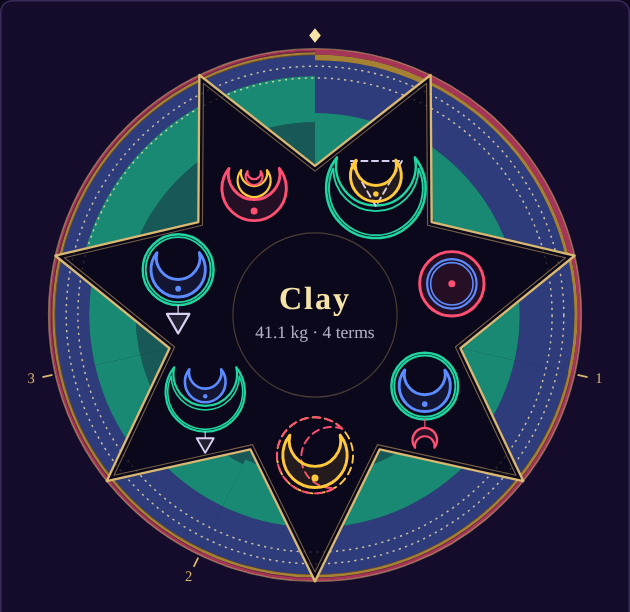
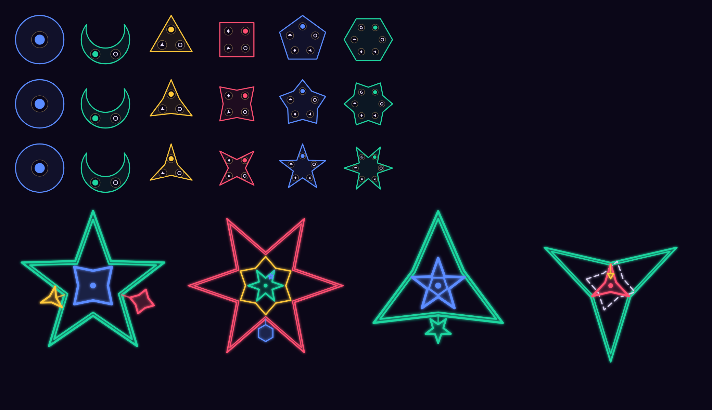
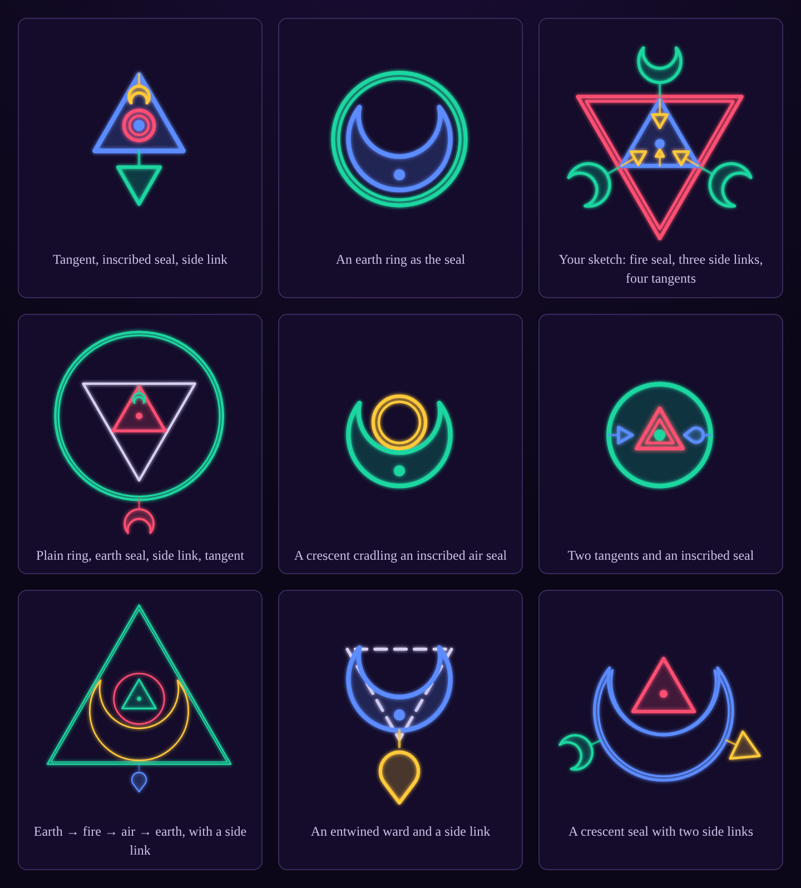

# herau-face

A roguelike deckbuilder of runes and alchemy, built from Circumgician's world. The design lives in [DESIGN.md](DESIGN.md); a new direction, cards as small circuits, in [CIRCUITS.md](CIRCUITS.md).

## Prototype: Circuits (new direction)

A run of four commissions (mud, a peat bog, a fumarole of air and fire, the Mire) on a moon dial of eight phases. Each card is a circuit: its input channels take instability of their element from the pool, up to their capacity, and its main output purifies that much times its gain, or grounds it. The opening deck splits in two: four metal makers that take 5 of one element and ground it for a principle, and six purifiers that take 3 each of two elements and purify them, one for each pair, plus the Sieve. A run opens by drafting a twelfth rune: one of three inputs (an element, any, or one that collects 3 from elsewhere: quintessence, a discard, an eighth more of the moon), then one of three outputs (purify, ground, Ward, catalyst, draw, spare an eighth, quintessence, or one of ten statuses such as Settle, Stall or Foresight). The shop can also add a Catalyst, which makes the next card purify ×2. Its side outputs fire once it has taken enough: the metal creators yield a principle (salt, sulfur or mercury, whichever the card is built for) from 4 or more; the Sieve raises Ward, 1 for each it takes. There are no turns: a card costs an eighth of the moon, a tick more for each gain. At every new and full moon you draw 4 and the commission feeds the pool in bulk; at the first and last quarters you discard your hand; at 3/8 and 7/8 of the moon the commission flares, and whatever is in the pool costs quintessence and stays. With nothing to play, the moon moves on by itself. Principles brew a tincture (Ward), a spirit (draw 2) or a homunculus (a helper that purifies at every phase). Between commissions what is left smelts into metal, and you add runes to cards: an input, a gain, a principle output or a ground stage.

It is all on one screen: the moon dial with the pool in its middle, materials and recipes, the hand, and the actions, with a note that always explains whatever you pick (beside the game on wide screens). The shop shows what a rune does and the card before and after. Cards are drawn as alchemical circuits on the runic schema in [CIRCUITS.md](CIRCUITS.md): stages are circles, inputs inside with leads to the rim, outputs outside, arcs for requirements; a crescent is time, a triangle an element, a square purification (a square around it multiplies it again). Each card lights up with what it would do on the pool as it stands.

```sh
npm run dev                          # then open /circuits.html
npx tsx scripts/circuits-sim.ts --compare                        # every strategy side by side
npx tsx scripts/circuits-sim.ts --drafts --runs 300             # runs won with each drafted input and output
npx tsx scripts/circuits-sim.ts --strategy delay --reserve 70    # one in detail (greedy, random, delay; --picks need|wet; --hand; --stock)
npm run build                        # also dist/circuits.html
```

The simulator has three players: greedy (whatever looks best right now), random, and delay (in the fights before the boss, keep the fight going for principles as long as a greedy finish would still leave a chosen reserve of quintessence). With 40 quintessence, greedy wins 76% of 600 runs with the eleven opening cards and 82% with a well-drafted twelfth; holding back for metal never beats it. The rules are in `src/circuits/engine.ts`; the drawings in `src/circuits/sigils.ts` (the sigil alphabet), `circuit.ts` (cards) and `dial.ts`; the page in `src/circuits/main.ts`.

## Prototype: mud to clay

One commission, playable end to end: 40 kg of mud (18 kg medium earth, 18 kg impure water, and 2 kg each of medium air and fire from its organics) to bring to clay before quintessence runs out. Clay is 75–85% earth, with air and fire each between 1% and 3%; bounds are strict.

Each term, mud shows its moves: each of its elements may act, the less pure the likelier. Tap a rune to anchor a sigil, then tap others and pick how each joins from the menu that opens around it. You compose and cast sigils from a 6-rune hand, as many as the hand allows; each resolves at once against an exact preview, and its Ward builds up for the term. When you end the term, mud acts: the term's Ward absorbs its flares and the rest costs quintessence. Unplayed runes stay in hand.

```sh
npm install
npm run dev        # play locally
npm test           # rules tests
npm run simulate   # a simulated player through many commissions
npm run simulate -- --deck late           # a deck from late in a run (opening, mid, late)
npm run simulate -- --links 4 --hand 10   # every body +4 links, a 10-rune hand (also --power)
npm run simulate -- --deck late --farm 250  # grow the clay to 250 kg before finishing
npm run simulate -- --trace 3             # print the first 3 commissions cast by cast
npm run simulate -- --farm 400 --ignore-spec --planner  # how fast the opening deck can grow mass at all
npm run simulate -- --equation             # the alchemical equation instead of Reach × Force
npm run simulate -- --equation --deck combo   # an archetype deck: ward, combo, great, purity, mastery, thinning (each also -late)
npm run simulate -- --equation --deck purity --fine   # fine clay: half the earth must end pure
npm run power      # kilos each deck along the run can move in a term
npm run build      # dist/index.html, one self-contained page
```

The rules are pure TypeScript in `src/sim`, with no UI dependencies, so the simulator and tests drive the same code the page does. The page is plain DOM and SVG in `src/ui` and `src/main.ts`.

### Runes and motes

A rune is a body holding motes. The body is an N-gon with N bowls (a circle is a 1-gon, a crescent a 2-gon) and sets power and links; the motes in its bowls give the element and any abilities.

| Body | Power | Links | Bowls |
| --- | --- | --- | --- |
| Circle | 5 | 1 | 1 |
| Crescent | 5 | 1 | 2 |
| Triangle | 5 | 1 | 3 |
| Square | 5 | 1 | 4 |
| Pentagon | 5 | 1 | 5 |
| Hexagon | 5 | 1 | 6 |
| Heptagon | 5 | 1 | 7 |

Power belongs to each rune, not its shape: the table's power is only the default for runes made without their own, and the Sandbox sets any rune's power from 0 to 25.

| Mote | Effect |
| --- | --- |
| Basic sapphire, emerald, topaz, ruby | Sets the element: water, earth, air, fire |
| Link mote | +1 link |
| Reach mote | The sigil's Reach ×1.5 |
| Guard mote | +4 Ward |

The standard deck is 14 runes: 4 circles (one of each element), 8 crescents (two of each element, each with a link mote) and 2 elementless triangles (a link, a reach and a guard mote). It used to be 8 circles and 4 crescents; under the equation a one-link anchor can only seal, never aim, so the deck leans on two-link runes. The opening hand always holds a water and an earth; the rest of the shuffle is random.

**Links** are how many runes the anchor holds, so a circle anchor makes a two-rune sigil and a crescent or triangle anchor makes three. Links on joined runes do nothing until that rune anchors. A first version treated links as connections, so 2-link runes extended any sigil for free; the simulator showed typical hands building five- and six-rune sigils and finishing in one term.

### The table and the level's star

Cast sigils stay on the table around the amalgam, for show only: table balance and the strain it added were dropped, because their only decision was whether to play a useless rune for its balance, and the point is to play every rune.

When a commission ends, the end card draws its star: one point for every sigil cast, holding that sigil, and between the points the amalgam's composition after it (earth innermost, then water, air and fire, paler where less pure), so the level reads clockwise from twelve o'clock, start just right of the top and finish just left of it. Dotted rings mark the earth band and ticks mark where terms ended. "Copy the per-term record" in Term history copies a CSV of every term: the sigils, the shares after it, the flare, Ward and quintessence paid.



### Table machines (a Tuning switch)

Tuning, Table: Machines turns the table into a few machines (2–4). A cast sigil keeps its runes and stays; each term a machine can fire once with no runes from hand. It gains an open link for every term it stands, so runes from hand can be added first. Taking one apart frees its place (not in a term it fired) and drops its runes into the discard pile. On the page, tap a machine to fire it or add to it; "Take apart" sits under the row.

The point is shorter decisions: with 3 slots, the opening deck's decisions give 22 different results instead of 69, the best move takes 3.1 taps instead of 5, and the best move is usually firing a machine as it stands or adding one rune. Mud gets much easier (the opening deck pays a median of 2 in 3 terms instead of 12 in 6), but the late deck wins only 13% against the Mire: machines lock runes away and keep doing yesterday's job. Sending taken-apart runes back to hand wins the Mire 98% of the time, but then the player recomposes nearly every move. DESIGN.md has the numbers.

```
npm run simulate -- --equation --deck opening --machines 3            # table machines, 3 slots
npm run simulate -- --equation --deck late --machines 3 --commission mire --apart hand
npx tsx scripts/complexity.ts --deck opening --machines 3             # decision complexity with machines
```

Flags: `--growth N` (links a machine gains a term, 1), `--apart hand|discard` (where taken-apart runes go, discard), `--no-rebuild` (never take one apart).

### Sandbox

The Sandbox panel changes the commission in progress, live (any mote, archetype motes included, can go in any bowl): the mud's starting composition (kg and purity per element, which resets the amalgam) and the target bands; each body's power and links (bowls are fixed, one per side); the reach and guard mote values; any rune's body and motes, wherever it is in the deck; new runes straight into the hand; removing runes; and discarding from hand to redraw, as often as you like (a run has no discards of its own). Restarting keeps every change, and "Restart with the standard deck" undoes them. "Decks along a run" loads the opening, mid-run or late-run deck, on the start screen too. The Tuning panel covers the rest: rules, combat, surplus Force, flare size, quintessence, hand size, and sigils a term.

### Rules the doc leaves open

- **Floating sigils and the table, both.** Each cast sigil takes effect, then stays in a slot around the amalgam.
- **Surplus Force multiplies Reach.** This departs from the doc's formula, which caps Force at the requirement. Under the cap, the standard deck wins only half its commissions against mud (see below).
- **Reach × Force.** Kilos converted = Reach × Force ÷ the Force the change needs. The preview spells this out, runes show what they'd add under the selected join, and a tip compares the best side link and best circumscribe left in hand.
- **Inscribe.** An inscribed rune of the anchor's own element purifies the selected pool. Any other halves Reach, for small precise casts.
- **A commission finishes in range.** It ends the moment the amalgam is in range, whether a cast or the commission's own move at the end of a term put it there; that term's instability is paid first.

### Sigil art

Every sigil is drawn the way the design doc's notation reads (`src/ui/draw.ts`): the anchor innermost with a dot at its heart; circumscribed runes nest outward and inscribed runes inward, in runepath order; the seal has a double line; side links hang outside on stems, pointing out; tangents sit inside, pointing in, on stems to the edge they touch; entwined runes lace through, dashed. Where the sketch left room:

- A crescent holds what it rings, or what is inscribed in it, in its hollow. As a seal, its second line runs parallel to both arcs, the back and the hollow, and closes in shorter horns.
- Runes are N-gons with N bowls, from the circle (1) and crescent (2) to the heptagon (7). A polygon inside one of its own kind turns half a side, so nested triangles read as halves of a hexagram rather than as a seal's double line.
- Rarity shows in the shape: common polygons are plain, uncommon have shallow divots, rare are pointy stars. A circle is the sun: uncommon throws 8 short rays, rare 16 long and short. A crescent is the moon by phase, where a 1/4 moon is half the disc: a 1/8 moon when common (half its radius thick), 1/16 uncommon, 1/32 rare, with a faint line round its unlit rest. The Sandbox sets any rune's rarity; it changes only the drawing for now. Archetype decks mark their enablers uncommon and payoffs rare.



- Tangents sit in a polygon's corners (or a star's points), in a crescent's band and around a circle. Side links hang off a polygon's edges (or a star's divots), a crescent's back, or below a circle.
- A circle can't point, so a circle that points is drawn as a drop.
- On cards, motes are marks: a drop of colour for an element, a ring for a link, an arrowhead for reach, a lozenge for guard, a cross for boost. Archetype motes have marks of their own (a crucible, a loop for cohobation, a drop for distillation, an × for multiplication, an arrowhead pointing in for magnesia, and so on); the start screen lists the ones in the chosen deck. Slag is a dotted grey circle.



### Numbers

| Constant | Value |
| --- | --- |
| Reach | 0.2 kg per point of power (anchor and side links) |
| Force | 1 per point (anchor, circumscribes, inscribes) |
| Ward | 1 per point (entwines), plus guard motes |
| Chance to act | Each element, each term, by purity weighted by kilos: impure 50%, medium 25%, pure 10%, perfect 3% |
| Mud's moves | Each element: a flare move (weight 2) or its own move (weight 1): earth only tremors, water seeps 0.5 kg of earth into water, air evaporates 0.5 kg of water, fire scorches 0.5 kg of earth |
| Flare size | Flare moves 13–16, own moves 4–6, each × (0.4 + 1.2 × the element's share); no escalation |
| Quintessence, hand, discards | 100, 6, none (a Sandbox tool) |
| Sigils a term | As many as the hand allows |

### What the simulated player found

400 commissions with the standard deck and a player that plays greedily within each term: it keeps casting the best sigil while that beats ending the term.

| Player | Median terms | Spent: none | 1–15 | 16–30 | over 30 |
| --- | --- | --- | --- | --- | --- |
| Careful (wards when it pays) | 6 | 21% | 70% | 7% | 3% |
| Careless (never wards on purpose) | 5 | 4% | 17% | 30% | 50% |

The careful player casts about 2 sigils a term and wins every commission; the careless one loses 2%. With a 5-rune hand the careful player's median cost rises from 5 to 16, it loses 7% of commissions, and the median commission takes 10 terms. Mud's organics add about one hand size of difficulty: without them, a 5-rune hand plays like a 6-rune hand with them. With the doc's capped formula the careful player wins only 68%.

Organics also put air and fire to work. Per commission the careful player plays about 7.8 water, 7.7 earth, 6.7 air and 6.8 fire gems, where air and fire were almost pure defence before. Tables end out of balance by 2.6 runes and 3.7 sides on average, against 4.4 and 6.2 with two-element mud.

### Decks along a run

The power arc's target: by the end of a run of 20 or more commissions, mud to clay takes one term, two at most, or the player can play on and make far more clay than the mud held. Three decks stand for points along a run, each keeping the standard deck's 14 runes and upgrading a few, about one upgrade per commission:

- **Opening:** the standard deck, 6-rune hand.
- **Mid-run** (about 10 upgrades): each crescent becomes a triangle with two link motes, so it anchors four-rune sigils; 7-rune hand.
- **Late-run** (about 35 upgrades, counting each side): one crescent of each element has grown into a hexagon carrying four link motes and a reach mote, so it anchors six-rune sigils; 8-rune hand.

| Deck | Hand | Median terms | Done in 1 term | In 2 or fewer | Median spent | Clay made |
| --- | --- | --- | --- | --- | --- | --- |
| Opening | 6 | 6 | 0% | 0% | 5 | 35 kg |
| Mid-run | 7 | 3 | 0% | 17% | 0 | 54 kg |
| Late-run | 8 | 1 | 59% | 99% | 0 | 91 kg |
| Late-run | 10 | 1 | 91% | 100% | 0 | 106 kg |

**Ring chains are the mass engine.** Earth → air → fire → earth multiplies converted earth by 20 × 1 × 2 = 40. One late sigil, an earth anchor ringed by air, fire and earth with a side link, turned 2.7 kg of earth into 108 kg and finished mud as 145 kg of clay. The new earth dilutes the traces into their band, so one cast fixes everything. A loop needs three rings, so it opens only once an anchor holds three links; the opening deck can't make one. A player that holds off finishing (`--farm`) grew the late deck's clay to 440 kg, 11 times the mud, in a median 7 terms for 2 quintessence.

**The opening deck can't overkill.** Asked to finish with even 41 kg of clay, 1 kg more than the mud held, the planning player lost 98% of commissions, bleeding quintessence over 24 terms. Chasing mass alone, it grew the amalgam to as much as 247 kg, but over three quarters of it was air from earth → air at ×20. Without three-ring loops, every gain lands as the wrong element, and three air runes with small Reach can't turn 100 kg of air back into earth before the stock runs out.

**What moves the arc,** with every body given extra links (`--links`):

- **Hand size most.** Finishing takes a bulk sigil plus trace fixes, so the right runes must be in hand together. With 4 extra links, one-term finishes went from 42% with a 6-rune hand to 85% with 8 and 96% with 10.
- **Links open chains,** then level off: 6 extra links did no better than 4.
- **Raw power hurts precision.** Power 8 instead of 5 cut one-term finishes from 85% to 52%, because the smallest sigil then overshoots a 2 kg trace.

The simulated player plans each term for big hands and high-link anchors: it tries the best sigil of every anchor and size, plus every ring chain of two or three, plays the rest of the term out greedily from each, and starts with the one that ends best. The opening deck still uses the exhaustive greedy player, so its numbers match those above.

### Sound and motion

`src/ui/sound.ts` synthesizes every sound with Web Audio: each element has a voice on one D minor pentatonic, so a cast sounds as a chord, arpeggiated from the anchor out to the seal, followed by a bell for what it did. The commission's turn thuds for each flare, chimes where Ward catches one and sinks for quintessence paid. The Sound button mutes it, remembered between visits. `src/ui/motion.ts` and the styles animate what changed: the glyph's amalgam eases between states, a cast sigil blooms onto the table, the commission's blows shake the glyph and Ward pulses round it, quintessence counts down, new runes deal in, and the end star draws itself clockwise. Each action records its effects once and the next render plays them, so tapping around doesn't replay them. Reduced-motion settings turn animation off. The glyph now sits below its legend: the amalgam's name, target chips and pool buttons come first.

### Archetype decks

Six archetypes, each with motes of its own (DESIGN.md, Archetypes), are playable from "Or an archetype deck" on the start screen and in the Sandbox, at the mid-run deck's budget with a 7-rune hand or a late version with an 8-rune hand. The motes are in `src/sim/deck.ts`, the catalysts in `src/sim/catalysts.ts`, the decks in `src/sim/presets.ts`.

| Archetype | Motes and catalyst | In play |
| --- | --- | --- |
| Consistent ward | Glaze (+2 Ward per rune in its sigil), crucible (+3 Ward when drawn), lute (its sigil's Ward lasts until spent), press (+0.5 power per Ward held) | Lasting Ward shows under the commission's moves |
| Combo | Cohobation (an anchor returns to hand), distillation (draw a rune after casting); the pelican (+2 Ward per return) | The anchor comes back after each cast |
| One great rune | Multiplication (its other motes count once more each cast), here with calcination on the great rune | Cards show how many times it has grown |
| Purity maxing | Rectification (a purifying step with it purifies two grades), digestion (a purifying sigil also takes a quarter of the pool); aqua vitae (+3 power while 80% of the amalgam is medium or purer) | Tick "Fine clay" for a purity target |
| Element mastery | Resonance (+2 power per other rune of its element in the sigil), magnesia (a seal that also draws other elements in, never past the middle of their bands) | The preview says what magnesia draws |
| Deck thinning | Calcination (burn a rune from hand after casting); the caput mortuum (+1 power to every rune per rune burned) | Choose what burns under the preview; the Burned pile opens from the bar |

Simulated with the equation (300 commissions each against mud and the Mire): the mid-run deck pays a median of 4 against mud in 3 terms and the late-run deck beats the Mire 67% of the time.

| Deck | Mud: spent, terms | The Mire, late: won | Signature |
| --- | --- | --- | --- |
| Consistent ward | 0, 5 | 89% | Ward absorbs 98% of mud's flares, 90% of the Mire's |
| Combo | 0, 3 | 93% | 4.0 sigils a term against 2.0 |
| One great rune | 4, 3 | 63% | Against the Mire it grows 3.2 times and moves 88% of the kilos |
| Purity maxing | 7, 4 | 69% | Fine clay in 7 terms; the mid-run deck takes 9 (21 before neutral runes purified) |
| Element mastery | 0, 2 | 97% | 39% of mud and 33% of the Mire finished in one term |
| Deck thinning | 4, 4 | 92% | Burns 1.7 runes against mud, 3.4 against the Mire |

Ward needed press to turn Ward into progress (42% against the Mire without it), magnesia had to stop at each band's middle (38% when it dragged traces under), and purity changes nothing until something asks for it, so fine clay is the prototype's first purity target.

### The alchemical equation

`src/sim/equation.ts` is a second model for what a sigil does. The page plays by it (Tuning switches back to Reach × Force), and the simulator runs it with `--equation`:

- **Resistance** = the material's base × the pool's grade multiplier × the step factor for every quality flipped along the runepath (a diagonal flips two).
- **Runepath:** from the anchor, walk the elemental square through the circumscribed and inscribed runes, easiest step first, ties going earth, fire, air, water. It ends at the seal, the last of those runes placed with an element, whose element is the output. Neutral runes (no element) come after the seal; with none elemental, the last neutral rune seals at the anchor's element.
- **Input kg** = neutral take × min(1, power ÷ resistance) × (reach up ÷ reach down) ^ ln(1 + power ÷ resistance). The neutral take is a flat 1 kg, a property of the material, so a heavier pool takes more work. Reach up is the anchor plus side links, times reach motes; reach down is the anchor plus tangents, a join that touches at a point; power is the anchor plus circumscribes and inscribes.
- **Output kg** = input × 1.1 per circumscribe ÷ 1.1 per inscribe. A boost mote adds 0.1 to its rune's multiplier. Element yields don't apply. Every step that keeps the element purifies (+1 grade, one more step of resistance), inscribed or circumscribed: a repeated element or a neutral rune. Everything transmuted comes out impure, so water → earth → earth makes medium earth, and so does water → earth inside a neutral ring. Purifying that a later change of element wipes out costs nothing. Sigils never adulterate; slag on the path does nothing.

Defaults: base 3.5, step ×2, a flat 1 kg take, power gate on. `--mix C:K[:T]` tries a starting deck of C circles and K crescents per element (and T plain triangles).

Against mud, 60 commissions each:

| Deck | Hand | Median terms | Done in 1 term | In 2 or fewer | Median spent |
| --- | --- | --- | --- | --- | --- |
| Opening | 6 | 7 | 0% | 0% | 3 |
| Mid-run | 7 | 4 | 0% | 17% | 0 |
| Late-run | 8 | 2 | 5% | 95% | 0 |
| Late-run, +1 link on every rune | 10 | 1 | 75% | 100% | 0 |

A one-link anchor plus its seal always takes the neutral 1 kg, so the deck mix matters. At base 5, 8 circles and 4 crescents took a median 18 terms and lost 30% of commissions; 4 and 8 took 13; all crescents took 9. A share-of-pool take instead (`--neutral 0 --share 0.2`) makes every pool fall in the same number of casts whatever it weighs.

### Mud's pressure

With the equation and the 4-circle, 8-crescent deck, the old mud (flares of 11–15 rising a point a term, nothing on its other moves, strain of 1 per 2 points past 2) cost the opening deck a median of only 4 quintessence. Raising pressure by escalation fattened the tail instead of the middle. Flares of 16–20 that don't escalate, small flares of 4–6 on seep, harden and slump turns, and a point of strain per point of imbalance past the first give the shape the design doc asks for (60 commissions each):

| Mud | Opening: median spent (p90) | Won | Median terms | Mid-run spent | Late-run spent |
| --- | --- | --- | --- | --- | --- |
| Old | 4 (11) | 100% | 6–7 | 0 | 0 |
| New | 8 (15) | 100% | 9 | 2 | 0 |
| New, flares +½ a term | 12 (54) | 93% | 9 | 3 | 0 |

Under the new mud, 3% of opening commissions cost nothing, 23% cost 1–5, 67% cost 6–15 and 7% cost 16–30. Flags: `--flare-min`, `--flare-max`, `--flare-rise`, `--debuff-flare`, `--act`. (Strain has since been dropped.)

These numbers predate purity. Under purity-driven combat (next section) the opening deck spends a median of 13 (p90 33), mid-run 4 and late-run 0.

### Purity and combat

Grades are purity now: impure, medium, pure, perfect. Purer elements resist change more (×0.5, ×1, ×2, ×4) and act less. Each term every element in the amalgam may act, so all four can go at once or none; an acting element picks a flare move or its own move, and moves land by its share of the amalgam. The intent panel lists each element's move and, under it, next term's chance for each element to act, which a previewed sigil updates.

Everything a sigil transmutes comes out impure, so working the mud stirs it up and the threat follows the bulk into the new earth. Purifying (inscribe the element the runepath is at) is the defence. The simulated player weighs next term's expected flares (`--threat-weight`, default 1.5), but still purifies only about once a commission: an opening sigil purifies 1–3 kg of 30, and the chance to act is weighted by kilos.

| Deck | Mud: median spent (p90) | Terms | Purifying sigils |
| --- | --- | --- | --- |
| Opening | 13 (33) | 6 | 1.2 |
| Mid-run | 4 (18) | 3 | 0.5 |
| Late-run | 0 (9) | 2 | 0.1 |

### Purity effects (the default)

Tuning's Combat switch picks between element moves (above) and purity effects, now the default (`--combat moves|purity` in the simulator). Under purity effects each element stirs half the time whatever its purity, and when it does, each of its pools does what its purity does, per 17 kg of it: impure flares 15; medium flares 5 and taints a tenth of itself to impure; pure and perfect lend Ward 3 against the term's flares. The intent panel lists what stirred and, below, each element's chance and what its pools would do next term.

| Fight | Deck | Result |
| --- | --- | --- |
| Mud | Opening | median 12 spent (p90 26) |
| Mud | Mid-run, late-run | median 4, 0 |
| The Mire (per 35 kg, signature move a third of the time) | Late-run | 67% won, wins median 46 (p10 1, p90 80) |
| The Mire | Mid-run, late+ | 0%, 95% |

Purifying still rarely pays for the opening deck: its purifying sigils move 2–3 kg. `--free-purify` (no extra resistance step) changed nothing. Flags: `--purity-chance`, `--purity-mass`, `--purity-flare`, `--purity-ward`, `--purity-taint`, `--boss-chance`, `--boss-purity-mass`, `--boss-signature`.

### Boss: the Mire

Pick it from the commission buttons on the start screen or in the sandbox (`--commission mire` in the simulator). A 180 kg bog to fire into brick, 80–90% earth with air and fire each 1–3%. It is restless: its elements act at 90/65/35/10% by purity (its water is impure, the rest medium). An element that acts flares two times in three; otherwise earth stiffens (resistance ×2 this term), water binds (one sigil this term) and fire throws slag (two power-1, no-link slag runes into your draw pile). Every move carries a flare of 14–18 scaled by the element's share.

| Deck | Won | Spent when won (median, p10–p90) | Terms when won |
| --- | --- | --- | --- |
| Mid-run | 0% | — | — |
| Late-run | 62% | 64 (28–88) | 5 |
| Late-run, +1 link, 10-rune hand | 95% | 28 | 3 |

Tuning flags: `--boss-resistance`, `--boss-flare-min`, `--boss-flare-max`, `--boss-stiffen`, `--boss-junk`, `--boss-mass`, `--boss-act`, `--boss-grades`. The simulated player now values progress twice as much as before (`--miss-weight 60`); at 30 it warded forever in cornered boss fights. With it, mud costs the opening deck a median of 13 (p90 24), mid-run 4 and late-run 0.

### Throughput

`npm run power` deals 200 hands from each deck and finds the most kilos its best sigils can take in one term from an unlimited impure pool, ignoring aim and defence: the game's damage per turn.

| Deck | Hand | Best sigil (p10 / p50 / p90) | Whole term (p10 / p50 / p90) |
| --- | --- | --- | --- |
| Opening | 6 | 2.5 / 4.4 / 4.4 | 4.4 / 6.3 / 7.0 |
| Mid-run | 7 | 4.4 / 7.6 / 13.2 | 7.0 / 10.2 / 15.7 |
| Late-run | 8 | 38.8 / 82.1 / 177.8 | 39.8 / 83.1 / 178.8 |
| Late-run, +1 link | 10 | 142 / 307 / 703 | 145 / 310 / 706 |

Throughput grows 13× to 50× over a run while the job grows about 7× (mud needs about 15 kg moved, the Mire about 100 kg), so late fights are decided by flares and the boss's moves, not mass.
